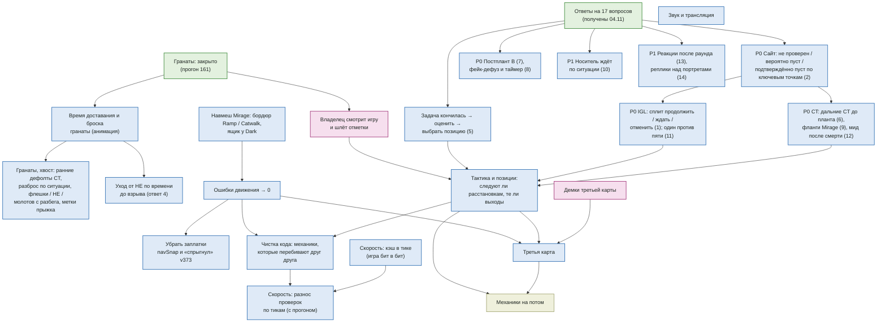

# Дорожная карта (04.11.2026)

Что не сделано по игре и в каком порядке. Шаги с галочками — `docs/PLAN.md`; ответы владельца на 17 вопросов —
`docs/tasks/OWNER_ANSWERS_2026-11-04.md` (числа там — стартовые, «проектное число»). Страницы: список —
https://claude.ai/artifact/EeChDiEgMvjyyp7myqqiEQ, граф — https://claude.ai/artifact/9aFVuvrkWnKaXBA2UNJ3MX.
Прежняя дорожная карта (20.10) — `docs/archive/ROADMAP-2026-10-20.md`. Обновлять, когда шаг закрыт или порядок меняется.

## Граф: что из чего следует
Стрелка «A → B»: B имеет смысл только после A. Без входящих стрелок — можно брать в любой момент. Номер в скобках — вопрос из ответов.

## Этапы
0. **Гранаты — закрыто 04.11 (прогон 161).** T ждут раскрытия смоков: вышли при летящем смоке 12 → 6,6 / 8,6 %, провалы смоков выхода Mirage 22 → 0.
   Остальное по гранатам владелец отложил (04.11).
1. **Гранаты — следом:** время доставания и броска (анимация; сейчас мгновенно, даже перед смертью); уход от HE по времени до взрыва
   (ответ 4); хвост — ранние дефолтные гранаты CT, разброс по ситуации (на ходу / под огнём / импровизация, ответ 16), флешки / HE /
   молотов с разбега, метки прыжка, этаж огня, тушение молотова смоком нарочно.
2. **Владелец смотрит игру сам** и шлёт отметки (новые замечания — `docs/PRINCIPLES.md` с М177).
3. **Движение:** навмеш Mirage (бордюр Ramp / Catwalk, ящик у Dark) → ошибки движения → 0 → убрать заплатки `navSnap` и «спрыгнул»
   v373; спуск со спавна T по рампе.
4. **Решения по ответам владельца** (приоритеты — из ответов):
   - P0 сайт: не проверен / вероятно пуст / подтверждённо пуст — по ключевым точкам сайта и подходам (поле набора карты) (2);
   - P0 IGL: сплит — продолжить / ждать / отменить, оставшийся не обязан идти вместо погибшего (1); один против пяти — поставить /
     другой сайт / сейв по экономике, времени, инфе (11);
   - P0 CT: дальние CT до планта — не по одному в готовую оборону (6); фланги и ротации Mirage — маршруты в набор карты (9); мид после
     смерти своего — Window + Connector, не оба в Window (12);
   - P0 постплант B — оба на сайте по умолчанию, Market — по условиям (7); фейк-дефуз и математика таймера (8);
   - задача кончилась → оценить → выбрать позицию, а не «назад на пост» (5);
   - P1 носитель ждёт по ситуации 1,5–4,5 с, 8 с — только «держим» (10);
   - P1 вид: реакции после раунда — победители, потом проигравшие (13); реплики над портретами — короткие коллы по роли (14).
   Уже так: тренер меняет вероятности (3), флешка — по каждому в миг взрыва (17), `lobErr` без пикселей (16).
   Нужна отметка владельца: пункты 29, 32, 33 от 29.10 (15).
5. **Тактика и позиции** (по отметкам и после п. 4): следуют ли расстановкам, те ли выходы; таблица гранат выходов как у про ±10 %.
6. **Чистка и скорость:** кэш видимости и путей в тике (бит в бит) — в любой момент; механики, перебивающие друг друга; разнос
   тяжёлых проверок по тикам (с прогоном).
7. **Звук и трансляция** — в любой момент.
8. **Третья карта** — после движения и тактики; нужны демки.
9. **Потом:** IGL меняет расстановку в раунде, почерк соперника, фирменные раунды, комментатор, мораль (`docs/tasks/future_mechanics.md`).

Под вопросом (владелец решит после просмотра): сглаживание взгляда и трассеров, петля планта, фейк-плант (М154–М155).
Убрано (владелец 04.11): точность смоков у краёв уступов — облако закрывает и при небольшом промахе.
