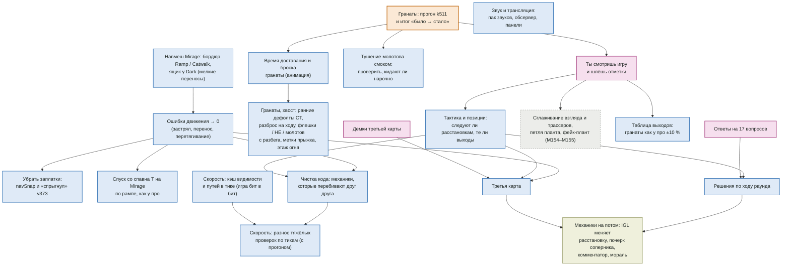

# Дорожная карта (04.11.2026)

Что не сделано по игре и в каком порядке. Подробные шаги с галочками — `docs/PLAN.md`, вопросы владельцу — `docs/OVERNIGHT_BACKLOG.md`.
Страницы: список — https://claude.ai/artifact/EeChDiEgMvjyyp7myqqiEQ, граф — https://claude.ai/artifact/9aFVuvrkWnKaXBA2UNJ3MX.
Прежняя дорожная карта (20.10) — `docs/archive/ROADMAP-2026-10-20.md`. Обновлять этот файл, когда шаг закрыт или порядок меняется.

## Граф: что из чего следует
Стрелка «A → B»: B имеет смысл только после A. Без входящих стрелок — можно брать в любой момент.

## Этапы
0. **Гранаты — закрыть (идёт).** Прогон k511: ждут ли T раскрытия смоков перед выходом, не срываются ли смоки выхода (v509–v511).
   Сделано и проверено цифрами: физика полёта, долгие смоки 14,8 → ~5 % (Mirage), флешка себе / тиммейту под пик, молотов выгоняет
   (88 % выходят за 0,9 с), ответная реакция как у про, колл «молотов на …» без ухода.
1. **Гранаты — следом:** время доставания и броска (анимация; сейчас граната вылетает мгновенно, даже перед смертью). Хвост — ранние
   дефолтные гранаты CT, разброс на ходу, флешки / HE / молотов с разбега, метки прыжка, этаж огня, тушение молотова смоком нарочно.
   Не критично.
2. **Владелец смотрит игру сам** и шлёт отметки (новые замечания — `docs/PRINCIPLES.md` с М177).
3. **Движение:** навмеш Mirage (бордюр Ramp / Catwalk, ящик у Dark) → ошибки движения → 0 → убрать заплатки `navSnap` и «спрыгнул»
   v373; спуск со спавна T по рампе.
4. **Тактика и позиции** (по отметкам): следуют ли расстановкам, те ли выходы; таблица гранат выходов как у про ±10 %; решения по
   ходу раунда (после ответов на вопросы).
5. **Чистка и скорость:** кэш видимости и путей в тике (бит в бит) — в любой момент; механики, перебивающие друг друга; разнос
   тяжёлых проверок по тикам (с прогоном).
6. **Звук и трансляция** — в любой момент.
7. **Третья карта** — после движения и тактики; нужны демки.
8. **Потом:** IGL меняет расстановку в раунде, почерк соперника, фирменные раунды, комментатор, мораль (`docs/tasks/future_mechanics.md`).

Под вопросом (владелец решит после просмотра): сглаживание взгляда и трассеров, петля планта, фейк-плант (М154–М155).
Убрано (владелец 04.11): точность смоков у краёв уступов — облако закрывает и при небольшом промахе.
