# Разбор движка против демок про (ENGINE_AUDIT)

Шаг 0а — нижний этаж: данные карты и движок (видимость, высоты, ходьба). Шаг 0б (знание о врагах, стрельба, итоговый порядок
работ) — дописывается ниже отдельным разделом. Игра в этих шагах не менялась.

## Шаг 0а. Карта, видимость, ходьба (20.10.2026, игра v385 = v384)

### Коротко

| # | поломка | у про | у нас Mirage | у нас Ancient | откуда | бьёт по игре |
|---|---|---|---|---|---|---|
| В1 | убийство про, а наш движок «не видит» (visParts, те же точки и высоты) | 0 % | **23,4 %** | **41,2 %** | см. В2–В7 | сильно: четверть (Mirage) и почти половина (Ancient) настоящих линий боя у нас невозможны |
| В2 | …из них режет высокая стена набора | 0 % | 6,0 % | **35,5 %** | Ancient — стены нарисованы руками, лезут на проход (углы, двери); Mirage — сборка: край уступа «чёрный на радаре» стал стеной (B Apps) | сильно |
| В3 | …режет пол/уступ сетки видимости | 0 % | 6,3 % | 2,1 % | код `visBuild` + набор (ящики с навмешем сверху, уступы) | средне |
| В4 | …виден край тела цели (центр закрыт, плечо ±14 ед. открыто) | 0 % | 4,7 % | 2,6 % | код: проверяется только линия «центр → центр» | средне (углы, ящики, пики) |
| В5 | …режет укрытие набора | 0 % | 3,7 % | 0,8 % | набор: 45 из 75 укрытий Mirage без измеренного верха = «бесконечно высокие» | средне (A сайт Mirage) |
| В6 | …линия под верхним полом (сетка знает один пол) | 0 % | 1,2 % | 0 % | код `visBuild`: один пол на клетку | слабо, но в одном месте (Shadow, Underpass) |
| В7 | …чужой этаж / крыша | 0 % | 1,1 % | 0,1 % | `levelBlocked`, потолок 130 (проектное) | слабо |
| В8 | пары, которые не стреляли 2 с, смотря друг на друга, а движок «видит» | ~0 % | 1,6 % | 0,3 % | — | слабо: «видит сквозь стены» почти нет |
| Н1 | высота про ≠ наш этаж навмеша > 30 ед. | 0 % | 0,8 % | 0,4 % | набор: наклонные участки плоские; ящики/машины/плиты без навмеша | слабо |
| Н2 | высота про ≠ `visFloorAt` > 30 ед. (её берёт `hasLOS`) | 0 % | 2,1 % | 0,6 % | код: `hasLOS` берёт верхний пол, а не высоту бота | слабо–средне (98 вызовов `hasLOS` в мозге) |
| Х1 | бот «вне навмеша — перенесён» на 100 раундов | 0 | 758 | 438 | заплатка `navSnap`; бот сходит с пола | средне |
| Х2 | `stall` на 100 раундов | — | 1891 | 2124 | | |
| Х3 | …из них «ходит туда-сюда» (путь есть, прошёл > 60 px, сдвиг < 25 за 5 с) | — | **49 %** | **45 %** | код: путь меняется 3–5 раз за 5 с | сильно: бот топчется, а не идёт |
| Х4 | …«нет пути до поста» / «путь сброшен застреванием» | — | 28 % / 17 % | 33 % / 19 % | код ходьбы | средне |
| Х5 | …«стоит по задаче» (holding / скорость 0 по решению) | — | 5 % | 3 % | — | норма |
| П1 | места, где про бывают, а боты нет (доля времени про там) | — | 5,6 % | 5,3 % | стены/укрытия/высоты (В2–В5), уход с края пола | средне: про держат углы у стен и ящиков, боты — нет |
| П2 | места, где боты бывают, а про нет (доля времени ботов там) | — | 0,2 % | 0,03 % | — | нет |

**Главное.** Нижний этаж ломает игру сильнее всего в **видимости**: на Ancient 41 % настоящих убийств про наш движок считает
невозможными, почти все — из-за стен набора, нарисованных руками; на Mirage — 23 %, из-за стен сборки на краях уступов (B Apps),
ящиков A сайта и проверки «центр → центр». Обратной ошибки (видит сквозь стену) почти нет. Высоты набора в порядке (медиана
расхождения с демками 3–4 ед.). В **ходьбе** главная беда не «застрял в стене», а «ходит туда-сюда»: половина `stall` — бот с
путём проходит за 5 с ~200 px и остаётся на месте, путь за это время меняется ~5 раз.

### Как мерили

- **Видимость.** Все убийства пулей/ножом из демок (Ancient — 92 демки, 7113 убийств; Mirage — 86 демок, 6988). XY убийцы и
  жертвы — из `player_death`, Z — ближайший тик `ticks` (≤ 16 тиков). Прострелы (`penetrated > 0`) — отдельно, в основную долю не
  идут. Вопрос движку — `visParts(убийца, стоя → жертва, стоя, стены, z убийцы, z жертвы)` на собранной странице (`sim.html` v385),
  плюс все сочетания «присел», `hasLOS` и разбор, где именно режет линию (стена / пол / укрытие / потолок / этаж). Совпадение
  кадров проверено: XY из `player_death` против `ticks` — медиана 1 ед.; демки на навмеше — 99,2–99,6 % точек.
- **Обратная проверка.** Пары живых врагов раз в 1 с, ≤ 600 px радара, оба на земле, линия не через дым, оба 2 с не стреляли и не
  умерли; отдельно — где хотя бы один смотрит на другого (±15°). Про, который видит врага перед прицелом, стреляет быстрее 2 с, так
  что «движок видит» здесь — почти наверняка ошибка. Проверка слабее прямой (видимость в демке не записана).
- **Высоты.** Про на земле (вторая разность Z по тикам < 2 ед. — не прыжок, не падение), раз в 1 с, 250 000 точек на карту:
  Z против `visFloorAt` и против этажа навмеша под точкой (`navAt`).
- **Ходьба.** 8 матчей на карту (`--matches=3,7,11,13,17,19,23,29`), обычный сторож + сторож ходьбы (`tools/measure/engine/walk_watch.js`,
  только запись): точка каждого переноса `navSnap`, сброса пути «нет прогресса 1,5 с», «топчется → escapeWallLine», «спрыгнул с
  уступа»; у `stall` (как в `watch.js`) — сколько из 5 с бот хотел идти, сколько прошёл ногами и сколько раз сменился путь.
- **Пути.** Доля времени по клеткам 32 px: боты (позиции раз в 16 тиков) против про (те же точки высот).
- Скрипты: `tools/measure/engine/` (`demo_prep.py`, `vis_check.js`, `engine_audit.py vis|walk`, `walk_run.py`, `zoom.py`,
  `cases.py`, `wallend.py`, `slope.py`). Цифры — `tools/measure/runs/e0a_vis/<карта>_{vis,walk}_stats.json`.

### 1. Видимость

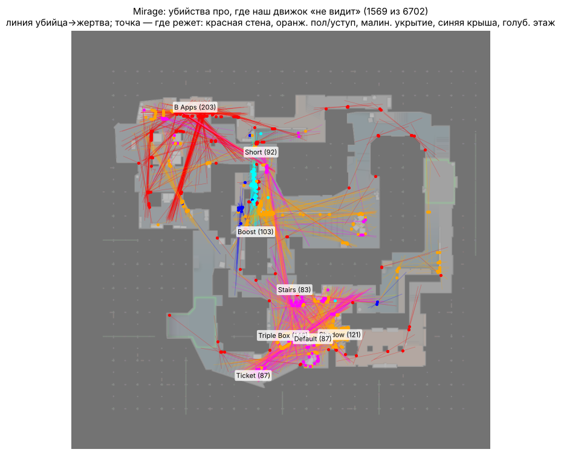
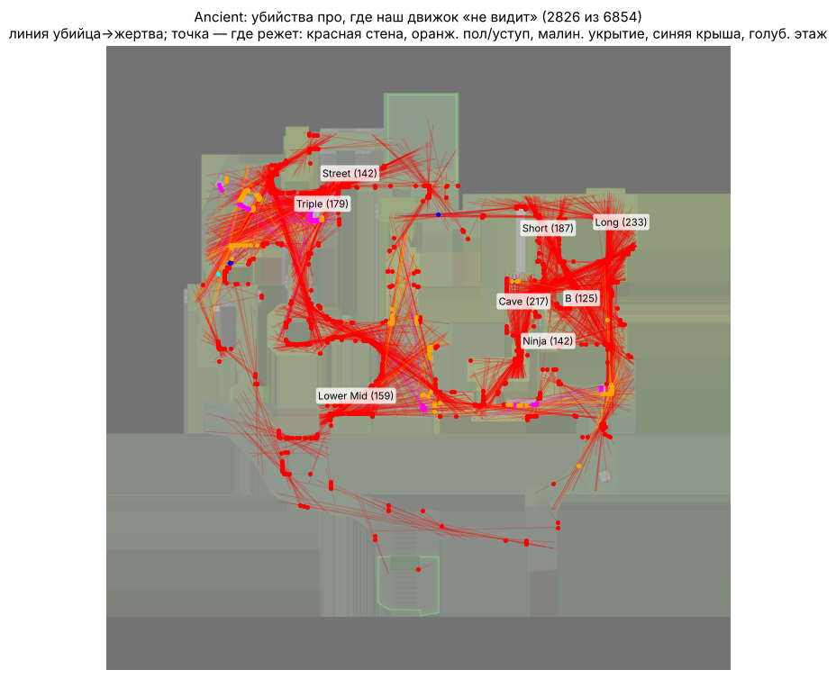

| | Mirage | Ancient |
|---|---|---|
| убийств пулей без прострела | 6702 | 6854 |
| движок «не видит» стоя | **23,4 %** | **41,2 %** |
| не видит ни в одной стойке | 23,2 % | 41,2 % |
| оба на земле (без прыжков) | 24,2 % | 42,3 % |
| `hasLOS` «нет» | 23,6 % | 41,5 % |
| прострелы: движок видит | 37 % из 286 | 15 % из 259 |
| видно со сдвигом цели ±14 ед. (плечо) | 29 % от «не видно» | 28 % от «не видно» |
| обратная проверка: «видит», хотя не стреляли 2 с (все пары / смотрел на врага) | 0,6 % / 1,6 % | 0,1 % / 0,3 % |

Разбор «не видно» (по первому совпадению, доля от всех убийств):

| причина | Mirage | Ancient | где чаще |
|---|---|---|---|
| высокая стена набора | 6,0 % (404) | 35,5 % (2430) | Mirage: B Apps 198, B Site, Door, Car; Ancient: Long 233, Cave 213, Short 187, Lower Mid 159, Street 142, Ninja 142 |
| пол / уступ сетки | 6,3 % (420) | 2,1 % (145) | Mirage: Boost 81, Triple Box 73, Default 42, Shadow 30, Window; Ancient: Tree, Ramp (B), Plat |
| край тела цели (центр закрыт, плечо видно) | 4,7 % (313) | 2,6 % (178) | Triple Box, Stairs, Tetris, Short; Ancient: Ramp (B), Triple, Tree |
| укрытие набора | 3,7 % (245) | 0,8 % (55) | Ticket 58, Short 38, Stairs 32, Triple Box; Ancient: Triple |
| под верхним полом (сетка знает один пол) | 1,2 % (81) | 0 | Shadow 73 |
| чужой этаж (`levelBlocked`) | 0,7 % (48) | 0 | Underpass 37 |
| тонкий выступ сетки ≤ 10 ед. | 0,5 % | 0,2 % | — |
| крыша (потолок 130) | 0,4 % (24) | 0,1 % | Window 18 (Mirage) |

Доля «не видно» по месту (убийца или жертва там, ≥ 25 убийств): Mirage — Stove 50 %, Market 50 %, Ladder Room 50 %,
Ticket 42 %, Firebox 41 %, **B Apps 40 %** (656 убийств), Mid Boxes 40 %, Short 36 %, Underpass 34 %; Ancient — Jungle 74 %,
Back Site 66 %, Street 66 %, Temple 65 %, Stairs (A) 64 %, Alley 60 %, Choke 58 %, Tree 58 %, CT Spawn 57 %, Long 56 %.

**В2. Стены Ancient — нарисованы руками, лезут на проход.** На Ancient линию режет стена в 2430 убийствах из 6854. Точка
реза — посреди линии (медиана 53 px от ближайшего игрока), а не «игрок прижат к стене»: обрезка линии на 8 px у концов снимает
только 180 случаев. Причина видна на картинке: углы стен выступают туда, где ходят про (зелёное), проёмы (выход из Cave на B,
Street) местами закрыты, стены идут ступеньками. 3,4 % всех позиций про на земле — внутри стен набора (Mirage — 0,4 %);
общего сдвига стен нет (лучший сдвиг ±12 px ничего не даёт) — ошибки местные.
Откуда: **данные набора** — `walls.json` Ancient заморожен (`_build.json`: «стены нарисованы владельцем в редакторе карты, не по
краю навмеша»), `.nav` Ancient в репо нет, собрать стены, как у Mirage, нечем.

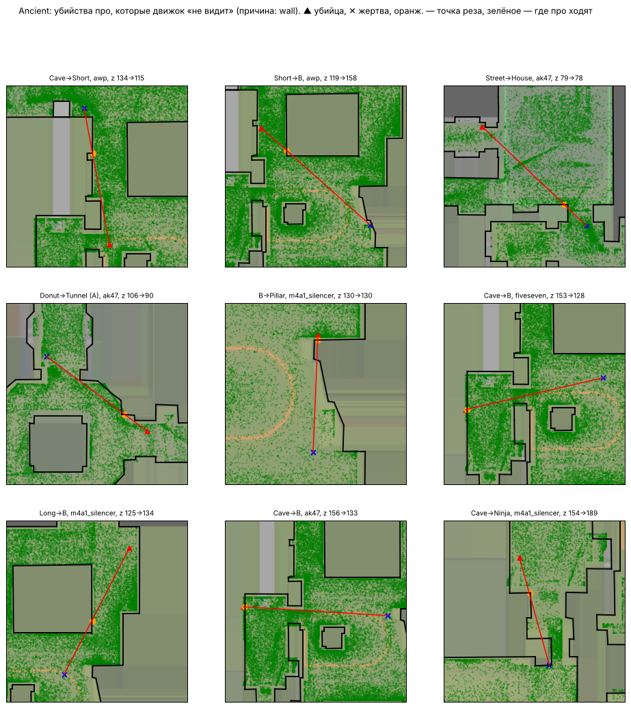
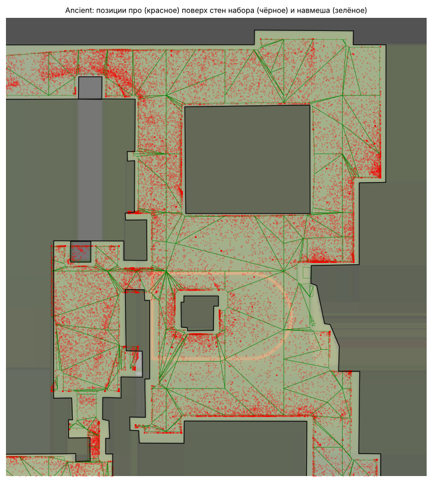
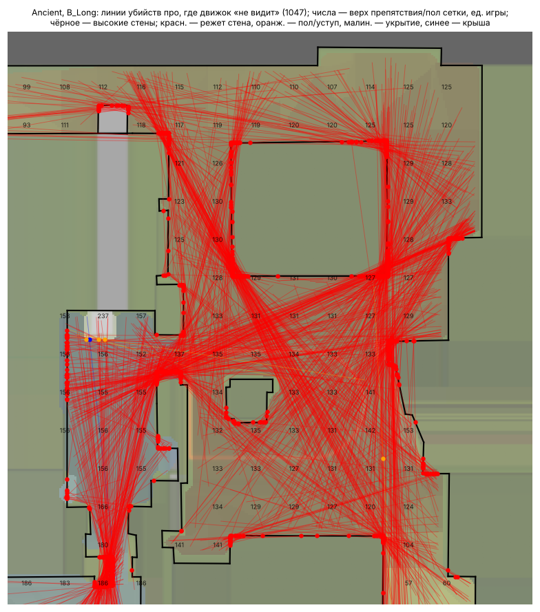

**В2. Стены Mirage — край уступа стал стеной (B Apps).** На B Apps режет полоса стены по краю балкона: игрок на Apps (z −48)
и на сайте B (z −166) друг друга видят, у нас — нет (198 убийств, 40 % всех убийств с участием B Apps). То же — тонкие полосы на
ступенях Short, у Door, Car. Откуда: **сборка** (`tools/map_build.py`, `step_walls`, `wallsFrom = "radar"`): стена = «чёрное на
радаре и не пол». Край уступа на радаре — тёмная линия, пола (навмеша) в щели между этажами нет, — и получается высокая
стена без верха. Это ровно отметка владельца «на B Apps нет стен» наоборот: стены там есть, но не те (и, по обратной проверке,
«видит сквозь» на B Apps ↔ Car — 17 пар).

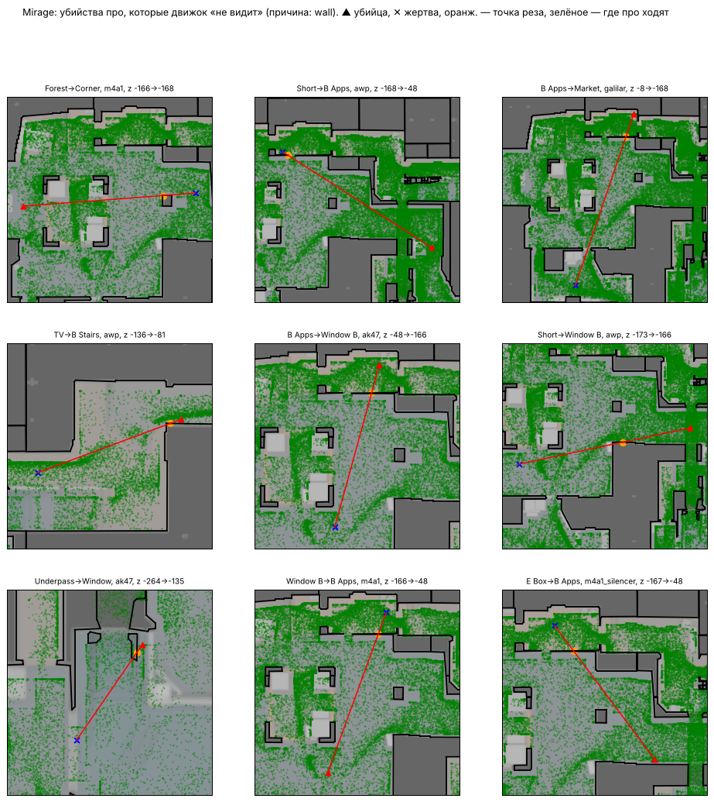
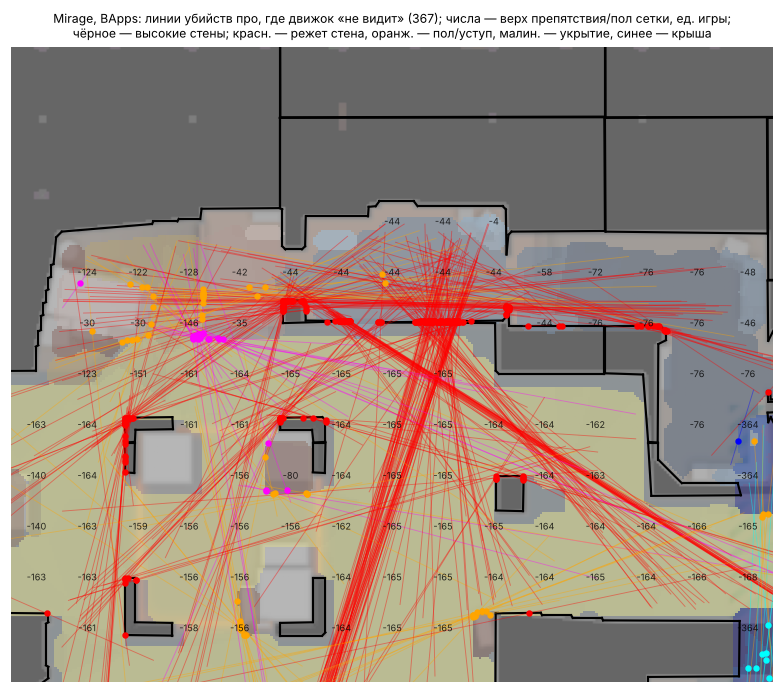

**В3, В5. Ящики и уступы A сайта Mirage.** Ящики Triple Box, Default, Ticket, Firebox с навмешем сверху попадают в сетку как
«пол» (верх ящика), остальные — укрытия; у 45 из 75 укрытий Mirage верх не измерен (`top: null`) и считается бесконечным. Линии
убийств режутся по краям ящиков (кольца точек на картинке) и глубоко (медиана — 40 ед. линии внутри препятствия), а не по
«ступенькам» сетки: сузить ящики на 5–15 ед. — снимается лишь 1–2 % убийств. Наклонные участки навмеша (325 штук, до 110 ед.
перепада) пол видимости почти не ломают (2 случая из 506). Значит, дело в высоте/размере самих препятствий в наборе и в проверке
«центр → центр» (В4), а не в разрешении сетки. Откуда: **набор** (`cover.json` без верха, навмеш на ящиках) + **код** (`visBuild`).

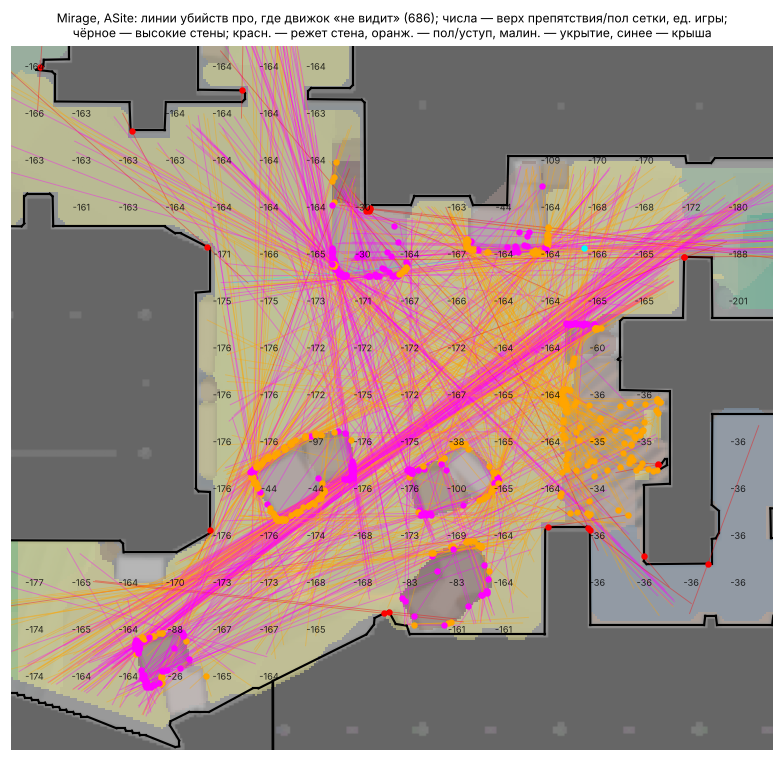
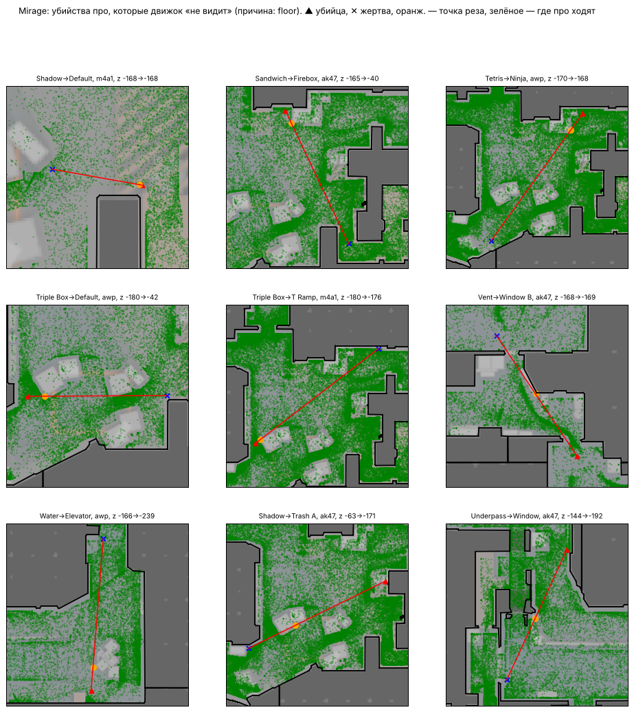
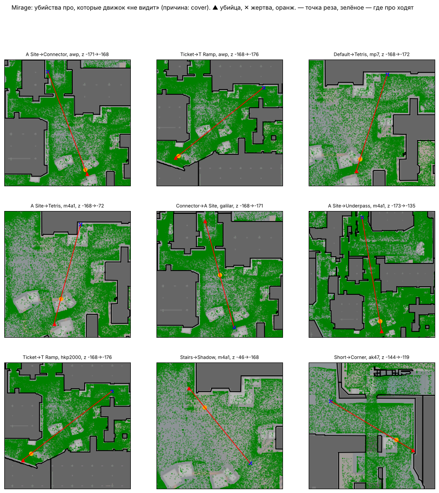

**В4. Проверяется только центр тела.** `visParts` ведёт линию от глаз (центр) к точкам головы и тела на оси цели. Игрок у
угла или ящика, у которого центр ещё за укрытием, а плечо уже видно, для нас невидим. Сдвиг цели вбок на ±14 ед. (плечо) делает
видимыми 29 % «не видно» на Mirage и 28 % на Ancient (в том числе часть «стенных»). Откуда: **код** (`040_visibility.js`).
Бьёт по пикам у углов — ровно там, где начинаются дуэли.

**В6, В7. Этажи и крыши Mirage.** Сетка видимости знает один пол на клетку — самый высокий. Игрок под балконом Shadow (z −168
под полом −35) смотрит сквозь «пол» верхнего этажа (73 убийства). `levelBlocked` режет 37 убийств у Underpass, потолок 130
(проектное число) — 18 у Window. Откуда: **код** (`visBuild`, `levelBlocked`, `VIS_CEIL_H`).

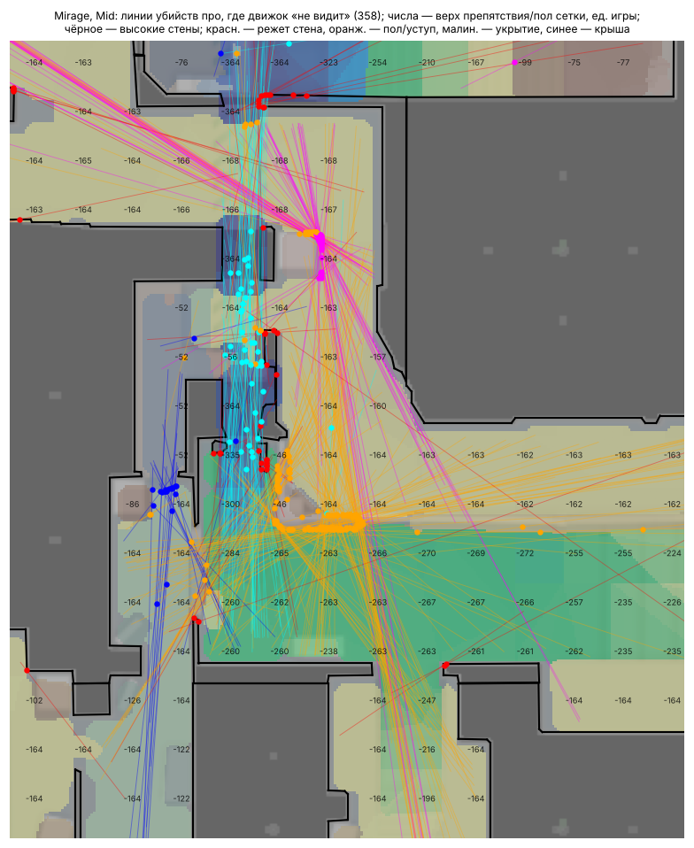

**В8. Обратная проверка.** Видит сквозь стены движок редко: из пар, которые 2 с не стреляли, глядя друг на друга, «видит» 1,6 %
на Mirage (T Ramp ↔ Tetris 41, Default ↔ Jungle 31, Default ↔ Tetris 25, B Apps ↔ Car 17) и 0,3 % на Ancient (A ↔ Tree 23).
Часть из них — настоящие линии, по которым про просто не стреляли.

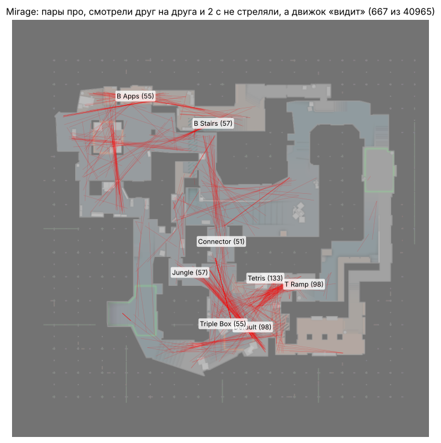

**Как бьёт по игре.** В движке `visParts` решает перестрелку (`resolveEngagements`), а `hasLOS` (98 вызовов) — взгляд, позиции,
таблицу «откуда простреливается», гранаты, знание о врагах. Линия, которой у нас нет, — это угол, который нельзя держать, и дуэль,
которой не будет. Видно по убийствам ботов (Mirage, 8 матчей, 1089 убийств; место убийцы, доля у про → у ботов): про чаще
убивают с B Site 2,5 → 0,6 %, Forest 1,9 → 0,1 %, Door 1,3 → 0 %, Underpass 3,0 → 1,8 %, B Apps 4,4 → 3,4 %; боты чаще — с
Triple Box 3,0 → 7,3 %, T Ramp 4,5 → 8,4 %, Ticket 3,9 → 6,1 %. На Ancient (1216 убийств ботов) ещё резче: с **Long** про
убивают 4,7 % — боты 0,2 %, Cave 7,2 → 3,5 %, Cat Walk 3,4 → 1,6 %, Ninja 2,9 → 1,2 %, Banger 1,8 → 0,4 % — ровно места, где
стены Ancient режут линии (Long 233, Cave 213); боты чаще — с Outside 2,5 → 6,7 %, A 2,6 → 5,3 %, Back Site 1,8 → 4,4 %.

### 2. Высоты и крыши

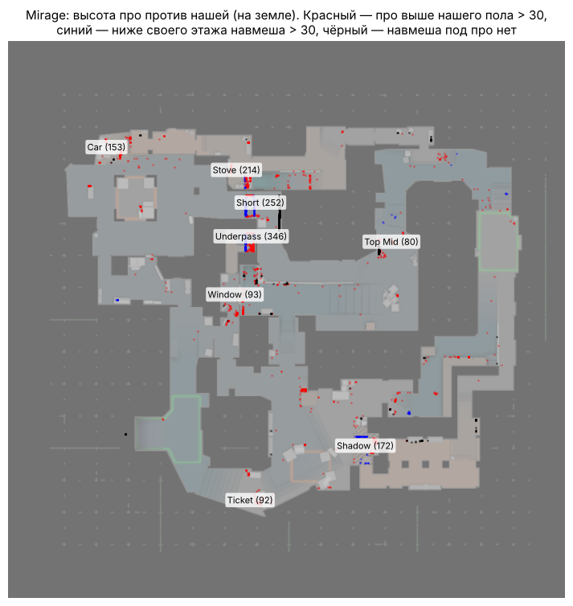
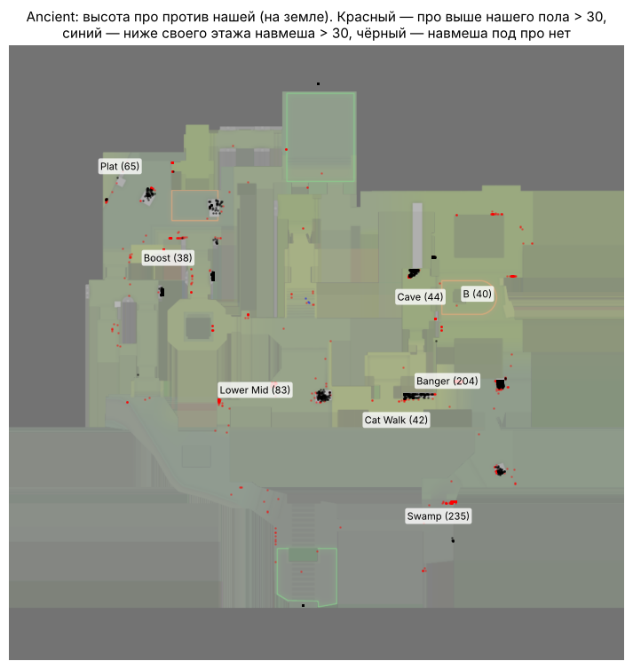

| | Mirage | Ancient |
|---|---|---|
| медиана \|Z про − этаж навмеша\| | 3,9 ед. | 3,3 ед. |
| \|Z − этаж навмеша\| > 30 | 0,8 % | 0,4 % |
| \|Z − `visFloorAt`\| > 30 | 2,1 % (из них про ниже верхнего пола 1,4 %) | 0,6 % |
| навмеша под точкой нет (±6 px) | 0,4 % | 0,8 % |

- **Н1. Этаж навмеша не той высоты** (Mirage — Underpass 346, Short 252, Stove 214, Shadow 172, Car 153; Ancient — Swamp 235,
  Banger 204). Из проверенных случаев Mirage 15 % — на наклонных участках: у `.nav` у каждого угла своя высота, а участок в игре
  плоский на средней (`a.z`), и на пандусе в 110 ед. концы ошибаются на ±55 (по углам — ≤ 30 у 82 % таких точек). Остальное —
  про стоят на предметах без навмеша (машина, плита, ящики, бусты). Откуда: **код** (плоский `a.z` в `visBuild` / `navAt`) +
  **набор** (навмеш не покрывает бусты). Бьёт слабо: эти точки — редкие позиции.
- **Н2. `visFloorAt` — верхний пол.** Под балконами и в Underpass (Mirage 1,4 % времени про) `visFloorAt` даёт пол верхнего этажа.
  `visParts` это поправляет высотой бота, а `hasLOS` — нет: там, где бот внизу, взгляд, позиции и «откуда простреливается»
  считаются с глаз на верхнем полу. Откуда: **код** (`hasLOS` в `050_nav_rebuild_paths.js`).
- **Нет навмеша.** Mirage: Top Mid 359, Short 242, Underpass 136 — полоса у Short/Underpass — это лестница (подъём по ней —
  не ошибка); Top Mid — бусты. Ancient: T Spawn 263, Ramp (B) 252, Boost 235, Cave 233, CT Spawn 203 — бусты и ящики (чёрные
  пятна). Откуда: **набор** (навмеш Ancient перенесён из v166).

### 3. Ходьба

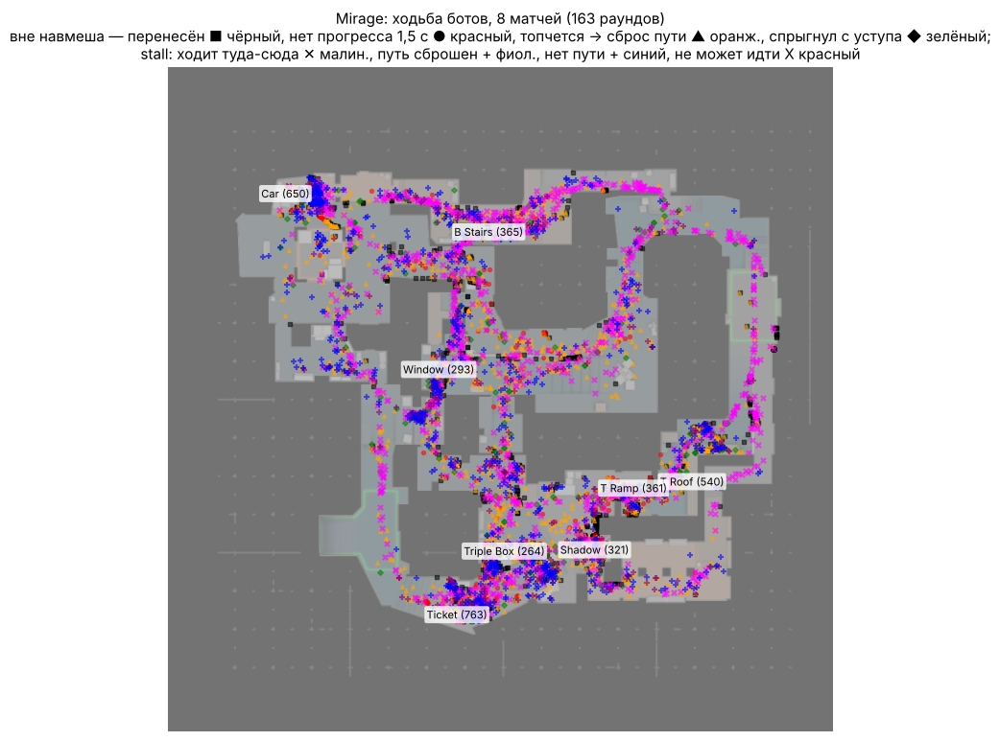
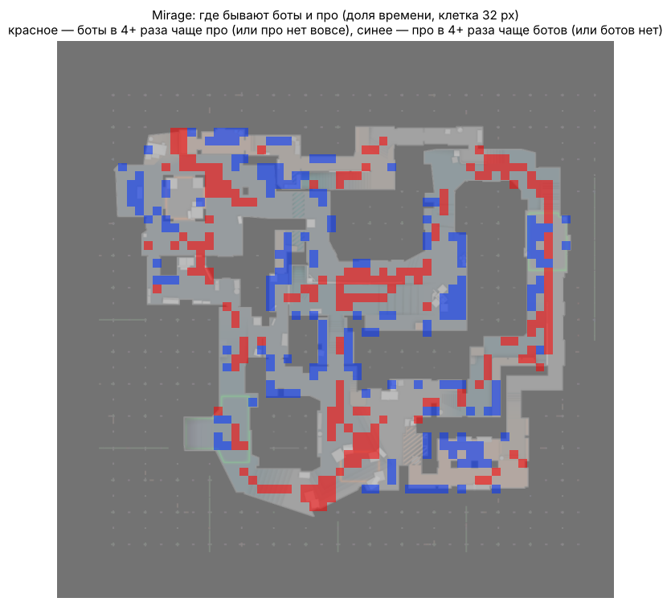

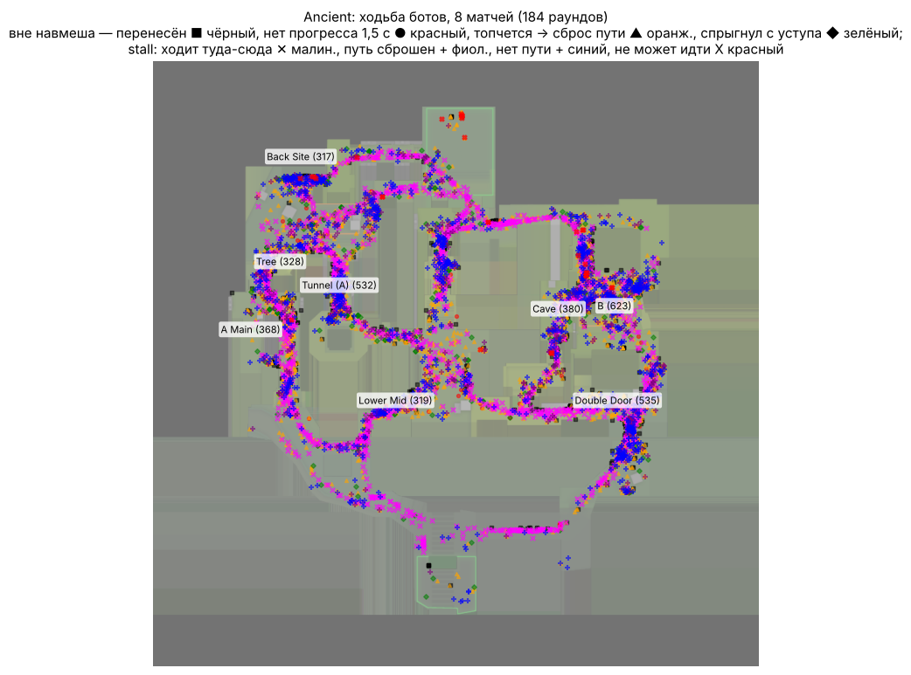
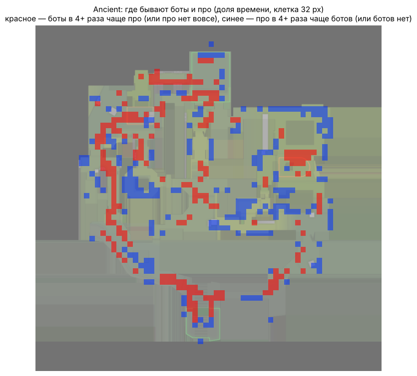

Сверка с замером шума (v384, Ancient, те же 8 матчей): `stall` 2124 против 2117, `nav` 438 против 444 на 100 раундов — сторож ходьбы считает то же, что `watch.js`.

| на 100 раундов | Mirage (8 матчей, 163 раунда) | Ancient (8 матчей, 184 раундов) |
|---|---|---|
| «топчется 1,5 с → сброс пути» (`escapeWallLine`) | 1233 | 1417 |
| вне навмеша — перенесён (`navSnap`) | 758 (медиана 8 px; со сменой высоты > 30 — 35 раз) | 438 (медиана 5 px; со сменой высоты > 30 — 9 раз) |
| спрыгнул с уступа на начало пути (заплатка v373) | 201 | 278 |
| нет прогресса 1,5 с — путь сброшен (`navUnlinkBlocked`) | 162 | 40 |
| `stall` | 1891 | 2124 |

`stall` по классам (доля всех `stall`):

| класс | Mirage | Ancient | что это |
|---|---|---|---|
| ходит туда-сюда | **49 %** | **45 %** | путь есть, бот хочет идти, за 5 с прошёл ногами > 60 px (медиана 204), а сдвинулся < 25; путь сменился медиана 5 раз на Mirage, 3 на Ancient (≥ 3 раз — 74 % / 62 %); у трети — рядом «топчется/перенесён» |
| нет пути до поста (без застревания) | 28 % | 33 % | пост есть, пути нет, застреваний не было |
| путь сброшен застреванием | 17 % | 19 % | путь снят переносом / «топчется» / «нет прогресса» |
| стоит по задаче (holding, скорость 0, бой) | 5 % | 3 % | норма |
| не может идти (путь есть, шаг не проходит) | 0,1 % | 0,9 % | стоит у стены с путём |

Где. Mirage: «ходит туда-сюда» — B Stairs 118, Car 116, T Roof 109, Ticket 107, T Spawn 85, TV 72; переносы — Ticket 273,
Car 131, T Roof 126, Shadow 98; «топчется» — T Roof, Ticket, Car, B Stairs. Ancient: «ходит туда-сюда» — Lower Mid 94, Tunnel (A) 94,
Double Door 93, Jungle 90, Street 84, Stairs (A) 82; переносы — Double Door 83, Tunnel (A) 81, B 73, Cave 62, A Main 54; «топчется» —
B 215, Double Door 198, A Main 171, Tunnel (A) 164. Посты на обеих картах — `contact`, `lineup`, `route`, `repos`, `anchor`.

- **Х3. «Ходит туда-сюда» — главное в `stall`.** Это не стена на пути (тогда бот стоит), а смена пути: за 5 с путь пересобирается
  ~5 раз, бот бежит то в одну, то в другую сторону. Треть случаев связана с застреванием (переносы и «топчется» снимают путь), две
  трети — нет: путь меняет кто-то ещё (новый пост `setPost`, пересчёт маршрута, смена этажа). Кто именно — этим сторожем не
  поймано; это первый вопрос для шага ходьбы. На картинках точки «ходит туда-сюда» (малиновые) идут вдоль всех маршрутов, а не
  кучкуются у стен, — значит, это код, а не карта. Откуда: **код** (`540_step_tick`, `110_post_routes`, мозг).
  *(Б1, 20.10: поймано сторожем — половина — реакция на контакт (`contactTick`, кончалась по таймеру при живом знании), ≈ 17 % —
  цель без поста в `assignNewDestination`. Контакт исправлен: «туда-сюда» −30 % Ancient / −34 % Mirage; DECISIONS 20.10, «Б1».)*
- **Х1. Переносы и «топчется».** Боты сходят с пола в местах, где стена набора лежит не по краю навмеша (Mirage: Ticket, Car, T Roof,
  B Stairs, Shadow; Ancient: B, Double Door, A Main, Tunnel (A), Cave), и заплатки (`navSnap`, `escapeWallLine`, «спрыгнул с уступа») их возвращают — около 24 событий на раунд на Mirage и 22 на Ancient. Откуда:
  **набор + код** (стены против навмеша; шаг `stepBlocked` / `offNavStep`).
  *(Б1, 21.10: в 85–90 % заплаток шаг никто не блокировал — считалась стоянка по делу, медленный шаг и шов между участками навмеша;
  переносы −93 % Ancient / −80 % Mirage, отталкивания −89 % / −86 %; остаток — стены набора не по краю навмеша; DECISIONS 21.10.)*
- **П1. Пути.** Туда, куда не ходят про, боты не ходят (0,2 % времени ботов). А вот про проводят 5,6 % (Mirage) времени там, где
  ботов нет вовсе: Pillars, Mid Boxes, B Apps, Corner, Forest, Jungle (Ancient 5,3 %: Donut, Alley, Long, Banger, Cave, Ninja) — углы у стен и ящиков, где про держат позиции. Боты ходят
  по середине проходов (красное), про — у края (синее). Связано с В2–В5 (у стены «ничего не видно») и с Х1 (у края пола бота
  уносит переносом).

### Поправки владельца к шагу 0а (20.10.2026)
- **Mirage, B Apps (в сторону Window / сайта B):** стены там есть и нужны — **ничего не удалять**. В стене два окна: в одно можно
  спрыгнуть (открыто — через него видно и можно пройти вниз), второе закрыто. Значит, правка — проём открытого окна в стене, а не
  снятие стены. Убийства Apps ↔ сайт B, которые режет стена, проверить: идут ли они через открытое окно.
- **Mirage, где стен не хватает** (отметка владельца «нет стен на B Apps») — это ближе к Short, «B дом» (как зона называется у нас —
  уточнить по слою зон).
- **Ancient, Long → A, «Boost»:** справа на выходе из Long — Boost: приподнятая площадка (клумба) с полом наверху, обнесённая
  каменным бортиком (снимок владельца: `engine_audit/owner_ancient_A_boost.png`). Пройти сквозь нельзя, залезть — только подсадкой;
  стоя на земле сквозь неё не видно, видно, если подпрыгнуть или стоять наверху. **Это не бесконечная стена, а возвышение с полом
  известной высоты**: в наборе — укрытие / этаж с верхом (высота — из демок: Z игроков, стоящих на Boost), ходьба — без подсадки не
  пройти, видимость — по высоте глаз (с земли — нет, сверху и в прыжке — да). Убийства с Long, которые режет это место, — проверить:
  не стоял ли кто-то на Boost / не прыгал ли.
- Вывод для правки видимости: **не править стены пачкой по статистике** — каждое место смотреть отдельно, картинкой, со знанием, как
  оно устроено в игре (окно, буст, подсадка); спорные — показывать владельцу.

### Откуда — сводно

- **Данные набора:** стены Ancient нарисованы руками (В2), укрытия без верха (В5), навмеш без бустов (Н1).
- **Сборка:** стены Mirage по «чёрному радара» — край уступа становится стеной (В2, B Apps).
- **Код:** видимость «центр → центр» (В4), один пол на клетку и плоские участки (В3, В6, Н1), `hasLOS` с верхнего пола (Н2),
  смена пути при ходьбе (Х3), заплатки переносов (Х1).

Ничего не чинилось. Что за чем делать — итог шага 0б (ниже).

## Шаг 0б (Б2). Знание о врагах и стрельба (21.10.2026, игра v386 = `bf18b3b`)

Игра не менялась. Боты — 8 матчей на карту (`--matches=3,7,11,13,17,19,23,29`, ПК владельца, прогон 16: Ancient 192 раунда, Mirage
174), про — 88 демок Ancient, 71 Mirage. Сторож `tools/measure/engine/know_watch.js` (только обёртки-записи) **игру не меняет**:
запись всех 16 матчей совпала бит в бит с прогоном 14 той же версии (`same_check.py`; отличаются только подписи «кто вызвал» в
стеке у сторожа ходьбы — обёртка добавляет туда свою строку).

### Коротко

| # | поломка | у про | у нас Ancient | у нас Mirage | откуда | чинить в |
|---|---|---|---|---|---|---|
| З1 | **видимость «видит сквозь»**: «видели» (радар команды) по линии, которой в игре нет (геометрия игры) | 0 % | — (нет геометрии) | **31 %** | видимость (стены радара, укрытия без верха) | А5 |
| З2 | …движок «увидел» врага, а в игре его закрывает стена (момент появления) | 0 % | — | **35 %** | видимость | А5 |
| З3 | …в игре враг виден раньше, чем увидел движок | 0 | — | 28 % появлений, в среднем на 0,37 с | видимость (В1–В4 шага 0а) | А5 |
| З4 | пост-плант стирает свежую инфу: вес места, где врага видели ≤ 5 с назад, до → после «плант» | — | 0,42 → **0,06** | 0,44 → **0,07** | код `knowPlantShift` (×0,152 всем) | Б3 |
| З5 | …а враг всё ещё там (≤ 300 ед. карты = 120 px от старой точки) | — | 77 % | 69 % | | |
| З6 | метка «видели №» на панели — на самом деле звук | — | 45 % меток | 39 % меток | код: `beliefLast` с `src: sound` рисуется как «видели» | Б3 |
| З7 | два места на одного врага: увидели в одном, звук того же врага в другом (> 300 px) | 1 | 1,4 % проб с звуком | 2,0 % | код: звук не привязан к увиденному врагу | Б3 |
| З8 | …у знания команды: «видели» + войс другим местом (оба ≥ 0,2) | 1 | 0,2 % проб | 0,6 % проб | `knowApply` кладёт войс новой веткой, не сливая с увиденным | Б3 |
| З9 | «видели», хотя и наш движок линии не видит: бросок гранаты / прыжок | 0 | 8 % / — | 23 % / 100 % (11) | код: `hasVision` / `visWallHit` вместо `visParts` | Б3 |
| З10 | штриховка: доля проверок, когда в заштрихованной зоне правда враг | — | 4,3 % | 4,7 % | заштриховано полкарты (31–34 из 59 / 26–31 из 54 зон) | Б3 |
| С1 | дуэль (первый выстрел → убийство), медиана | 0,31 / 0,30 с | 0,22 с | 0,33 с | | — |
| С2 | …по дистанции < 500 / 500–1000 / 1000–1500 ед. | 0,31 / 0,36 / 0,27 · 0,30 / 0,30 / 0,30 | 0,16 / 0,31 / 0,38 | 0,19 / 0,33 / 0,48 | стрельба: вблизи убивают слишком быстро, издалека — медленно | Б4 |
| С3 | хэдшоты среди убийств по дистанции (< 500 → > 1500 ед.) | 59–62 % → 40–42 % | 56 → 67 % | 55 → 55 % | стрельба: точность не падает с дистанцией | Б4 |
| С4 | хэдшоты пистолетом / винтовкой | 77–80 % / 50–51 % | 60 % / 60 % | 59 % / 58 % | | Б4 |
| С5 | первый выстрел дуэли: стоял (< 40 ед./с за 0,25 с до выстрела) | 26 % / 31 % | **69 %** | **74 %** | движение в дуэли: боты стреляют стоя | Б4 |
| С6 | …средняя скорость за 0,25 с до первого выстрела, медиана | 85 / 72 ед./с | 17 | 13 | | Б4 |
| С7 | от появления врага (линия + поле зрения) до выстрела, медиана | 0,23 с (Mirage) | — | 0,39 с | ≈ 0,1 с — видимость (З3), остальное — стрельба | А5, Б4 |
| С8 | …от появления в нашем движке до выстрела | — | 0,27 с | 0,28 с | мозг стреляет с реакцией про | — |

**Главное.** (1) На Mirage наша видимость ошибается в обе стороны и сильно: треть того, что команда «видит», в игре закрыто стеной
(З1–З2), а в четверти появлений враг в игре виден раньше (З3); вместе с шагом 0а (23 % убийств про «не видно») это главный
источник неправды и в знании, и в дуэлях — сначала видимость (А5), иначе Б3 и Б4 настраиваются на неверные линии. (2) В самом
знании главная поломка — фазы, а не «два якоря»: после планта вес свежей инфы падает в 6 раз (З4), хотя враг в 70–77 % ещё там;
«два якоря на одного врага» у знания редки (0,2–0,6 %), а на экране двойственность в основном от того, что звук подписан как
«видели» (З6). (3) В стрельбе дуэли в среднем не длиннее, чем у про (С1), но устроены не так: вблизи слишком быстро, издалека
медленно, точность не зависит от дистанции (С2–С4), и боты стреляют стоя в 70 % первых выстрелов против 26–31 % у про (С5–С6).

### Как мерили

- **Сторож** `know_watch.js`, раз в 16 тиков (0,25 с), пишет: «якоря» — места, где враг по знанию (вес гипотезы ≥ 0,2, места дальше
  300 px — разные; «инфа» — видели / слышали / войс / киллфид, без веток-прогнозов «ушёл туда» и «у бомбы»), отдельно для знания
  команды (`TEAMK`) и каждого бота, по состоянию (видят / инфа ≤ 10 с / старше / только спавн) и где враг на самом деле; панель
  взгляда (`heardSound` + `beliefLast`); каждый сигнал «видели» (`intelPush` spotted) — кто вызвал, что говорит `visParts`, дым, поле
  зрения, `_visible`, точки и высоты; штриховку (как рисует `lookDbgDraw`: `REACH ≤ tick` и `beliefZoneKnown < 0,03`) — эпизоды
  по зонам; взгляд при свежей метке «видели» (≤ 3 с, ≤ 1200 px) по фазам; `knowPlantShift` до/после; стрельбу — эпизод «враг в
  `_visible`» → первый выстрел, попадания (`applyDamage`), высоты ботов; коллы «беру …».
- **Геометрия игры** (только Mirage, `tools/map3d/raycast.py`, как А1): луч глаза 64 / 46 → голова 62 / грудь 44 / таз 30, ±12 ед.
  вбок; хоть один чистый — видно. Высоты ботов проверены лучом вниз: из 974 закрытых линий «видели» только 34 открываются на
  настоящем полу — дело не в высоте бота.
- **Стрельба** (`b2_shoot.py`, одно определение у про и ботов): дуэль — убийство из огнестрела; цепочка выстрелов убийцы в жертву и
  жертвы в убийцу назад от убийства, пока между ними ≤ 1 с (у про «в него» — ±25° по повороту); выстрелы ботов прорежены, как в
  наших демках (первый в окне 32 тика). Скорость — по позициям раз в 16 тиков, средняя за 0,25 с до выстрела. Реакция — назад от
  первого выстрела по пробам 16 тиков, пока соперник виден по геометрии и в поле зрения (±55°).
- **Чего нет в данных про:** выстрелы в репо прорежены (первый в каждые 0,5 с), `player_hurt` и скорости в момент выстрела нет —
  точность по выстрелам и контрстрейф за ~0,1 с у про не посчитать (нужен `parse_demos.py --events` на ПК владельца: `weapon_fire_full`
  с `velocity`, `player_hurt`). Взамен — хэдшоты среди убийств и средняя скорость за 0,25 с. У ботов попаданий на выстрел 53 %
  (Ancient) / 40 % (Mirage): винтовка < 500 ед. 79 / 68 %, 1000–1500 — 32 / 30 %.
- **Отметки владельца.** В базе Mirage (коллекция `marks`) сейчас 17 отметок, все — матч 1; отметок матча 2 (м2 р2: «беру Catwalk»,
  Stairs + Sandwich) там нет (удалены или на другой странице). Такие же случаи найдены в прогоне (ниже).
- Скрипты: `tools/measure/engine/know_watch.js`, `b2_know.py`, `b2_shoot.py`, `same_check.py`; цифры —
  `docs/reports/engine_audit/b2_know_{ancient,mirage}.json`, `b2_shoot.json`.

### 1. Знание о врагах

**Сколько мест на одного врага.** Доля проб, когда у знания команды на одного живого врага ≥ 2 места из инфы (вес ≥ 0,2): Ancient
0,2 %, Mirage 0,6 % (у ботов — 0,3 %). Пара почти всегда одна: «видели» (`held`) + войс другим местом (`moved:voice`) — 256 и 522
проб. Пример (Mirage, м13, CT про T0): видели на B Stairs 9 с назад (0,33) и войс «T Ramp» (0,27), а T0 на подходе к B. Звук или войс
о «каком-то враге» `knowApply` раскладывает по всем врагам, кого он может объяснить, и кладёт новой веткой рядом со старой точкой,
а не переносит её. С учётом веток-прогнозов («ушёл туда») ≥ 2 мест — 33–43 % проб со свежей инфой: это не ошибка, а развилка
(«ушёл на A или на мид»), так и у игрока.

**Что видит владелец на панели взгляда.** «видели №N» — это `beliefLast`, а туда пишется и звук: 45 % (Ancient) / 39 % (Mirage) меток
«видели» на самом деле со звука. Отдельно «звук» (`heardSound`) того же врага, у которого метка в другом месте дальше 300 px, —
1,4 % / 2,0 % проб с услышанным врагом (1057 / 1064 случая). Это и есть «видели на Stairs + звук у Sandwich»: две подписи одного
врага, одна из них — звук под именем «видели».

**Точность.** При инфе ≤ 10 с главное место знания команды ближе 300 ед. (120 px) к врагу в 51 / 50 % проб, дальше 800 ед. — 19 / 19 %.
Про (88 демок, `memory_pro.json`): через 5 с в 150 ед. от места, где видели, — 65 %, через 10 с — 43 %. То есть точность в пределах
того, что знает игрок.

**«Видели» без линии.**

| откуда «видели» | Ancient: сигналов / наш движок линии не видит | Mirage: сигналов / не видит | Mirage: движок видит, игра — нет |
|---|---|---|---|
| радар (`teamInfoTick`, враг в `_visible`) | 14 744 / 0,9 % (дым 5,9 %) | 18 750 / 1,3 % (дым 3 %) | **30,5 %** |
| смерть: убитый видел убийцу (`intelDeath`) | 1202 / 0 % (не смотрел на него 3,7 %) | 1049 / 0,6 % (4,8 %) | 22,5 % |
| видел бросок гранаты (`throwNade`) | 128 / 7,8 % | 221 / 23,1 % | 23 % |
| «чек прыжком» (`jumpCheckTick`) | — | 11 / 100 % | — |

В самом знании «видели без линии» мало: радар берёт ровно то, что видит движок. Ошибка — в двух местах кода, где «видел»
проверяется не той функцией: бросок гранаты — `hasVision` (стены радара + пол, без укрытий и стойки), прыжок — только
`visWallHit`; плюс смерть без поля зрения. Всё остальное — **ошибка видимости**: треть того, что движок «видит», в игре закрыто
(чаще: B Stairs ↔ E Box, T Ramp → Triple Box / Ticket, Car ↔ B Stairs, Top Mid → Window, Window B → Car — ящики и укрытия, которых
нет или которые ниже в нашем наборе). В шаге 0а обратная проверка по парам про давала 1,6 % — там места, где стоят про; боты
дерутся в других местах (П1 шага 0а), и там разрыв больше.

**Штриховка зон** (враг по таймингу мог дойти, команда его там не ждёт). В каждый момент заштриховано 31–34 из 59 зон Ancient и 26–31 из
54 Mirage; эпизодов ~370–410 на раунд. Живёт: медиана 3,9 с (Ancient) / 2,0 с (Mirage), четверть дольше 20 / 11 с, 10 % — дольше
45 / 32 с. Кончается: кто-то посмотрел на зону (`REACH` снова в будущем) — 58 / 61 % (медиана 1,8 / 1,3 с), пришла инфа — 16 / 18 %,
конец раунда — 27 / 22 % (медиана 31 / 21 с). Враг правда в заштрихованной зоне — 4,3 / 4,7 % проверок. Где враги на самом деле:
в заштрихованных зонах 36–49 %, в зонах, где команда их ждёт, 44–57 %, нигде — 5–8 %. Штриховка верна (почти никто не приходит
незамеченным), но слишком широкая: полкарты «может быть» и пусто в 95 % — для взгляда и решений это почти не информация.

**Фазы против инфы.** Бот не видит врагов, у команды свежая метка «видели» (≤ 3 с, ≤ 1200 px), без линии на неё; доля, когда он
смотрит в её сторону (±35°):

| фаза | Ancient | Mirage |
|---|---|---|
| идёт | 45 % | 57 % |
| на посту | 38 % | 52 % |
| лайнап | 25 % | 43 % |
| ретейк | 44 % | 50 % |
| пост-плант, T | 55 % | 57 % |
| пост-плант, CT (не ретейк) | 37 % (57) | 29 % (133) |
| (с линией на метку — любая фаза) | 90–96 % | 84–92 % |

Ретейк и пост-плант взгляд на инфу не перебивают сильнее, чем обычный пост. Перебивают причины взгляда: «угол про» — смотрит на
инфу 16 / 36 %, «открытое направление» 32–39 %, план взгляда (`look`) 38–55 %; против «контакт» 46–78 %, «смерть тиммейта» 45–71 %.
Зато **знание** фаза перебивает: `knowPlantShift` после «плант» умножает все гипотезы на 0,152 и ставит «у бомбы» 0,848 — вес места,
где врага видели ≤ 5 с назад, падает с 0,42–0,44 до 0,06–0,07 (88 случаев), хотя враг ещё там в 69–77 %. Пример (Mirage, м17):
T0 видели на миде 1,6 с назад (0,63) → после планта 0,10; T0 так и стоит на миде, в 680 ед. от бомбы. Про этот сдвиг взят из доли
«T в 600 ед. от бомбы после планта» (85 %) — средней по всем T, а не для того, кого только что видели в другом месте.

**Колл «беру Catwalk» из Market** — не знание, а ребаланс углов (`300_roles_fallback_rebalance`, «держит тот же угол — беру угол
<куда смотрит>»): в коле называется место, куда бот будет смотреть, а не где он стоит. Пример из прогона: Mirage, м11, CT1 в Market —
«CT3 держит тот же угол — беру угол на Catwalk». Таких коллов 64 на 8 матчей Mirage (133 — Ancient), в 25 % названное место дальше
700 px от сказавшего (A сайт → «T Roof»). Это колл (что говорить), шаг Д1.

### 2. Стрельба

| | про Ancient | боты Ancient | про Mirage | боты Mirage |
|---|---|---|---|---|
| дуэлей | 6980 | 1241 | 6171 | 1115 |
| длительность, медиана (четверти) | 0,31 с (0,09–0,70) | 0,22 (0,09–0,44) | 0,30 (0,09–0,66) | 0,33 (0,14–0,58) |
| …стреляли оба / только убийца | 0,50 / 0,09 с | 0,33 / 0,09 | 0,48 / 0,09 | 0,44 / 0,11 |
| …< 500 / 500–1000 / 1000–1500 / > 1500 ед. | 0,31 / 0,36 / 0,27 / 0,10 | 0,16 / 0,31 / 0,38 / — | 0,30 / 0,30 / 0,30 / 0,09 | 0,19 / 0,33 / 0,48 / 0,47 |
| стреляли оба | 61 % | 61 % | 57 % | 63 % |
| выиграл выстреливший первым | 69 % | 72 % | 70 % | 71 % |
| хэдшот среди убийств | 50 % | 56 % | 52 % | 54 % |
| …< 500 / 500–1000 / 1000–1500 / > 1500 ед. | 59 / 46 / 43 / 42 % | 56 / 54 / 67 / — | 62 / 50 / 42 / 40 % | 55 / 53 / 55 / 55 % |
| …винтовка / пистолет / AWP | 50 / 77 / 7 % | 60 / 60 / 9 % | 51 / 80 / 13 % | 58 / 59 / 5 % |
| первый выстрел: стоял / тормозил / медленно / шёл | 26 / 13 / 17 / 44 % | **69** / 12 / 9 / 10 % | 31 / 14 / 18 / 37 % | **74** / 9 / 7 / 10 % |
| средняя скорость за 0,25 с до выстрела, медиана | 85 ед./с | 17 | 72 | 13 |
| появление (геометрия + поле зрения) → выстрел | — | — | 0,23 с (0,14–0,38) | 0,39 (0,22–0,81) |
| появление в нашем движке → выстрел | — | 0,27 с (0,22–0,36) | — | 0,28 (0,22–0,41) |

- **С1–С2. Длительность.** В среднем как у про, но у про она от дистанции почти не зависит (0,3 с), у ботов растёт с 0,16–0,19 с вблизи
  до 0,38–0,48 с на 1000–1500 ед. На Mirage в дуэлях, где у стрелка есть линия по геометрии, — то же (0,19 / 0,33 / 0,53 / 0,55).
  Откуда: **код стрельбы** (`tryShoot`: попадание по дистанции; у ботов попаданий на выстрел винтовкой 79 → 32 %).
- **С3–С4. Точность.** У про хэдшоты падают с дистанцией (59–62 → 40–42 %) и сильно зависят от оружия (пистолет 77–80 %, винтовка
  50 %); у ботов хэдшотов ~55 % на любой дистанции и с любым оружием. Откуда: **код** (`tryShoot`: доля головы не от дистанции).
- **С5–С6. Скорость.** Боты в 69–74 % первых выстрелов стояли всю четверть секунды до выстрела (про — 26–31 %); в момент выстрела
  у ботов скорость < 40 ед./с в 82 %, но за 16 тиков до него ≥ 90 ед./с только в 39–43 %. Про подходят к выстрелу в движении (средняя
  скорость за 0,25 с — 72–85 ед./с; сам контрстрейф за ~0,1 с при пробах раз в 0,25 с не виден — нужны скорости из `weapon_fire_full`).
  Откуда: **код движения в дуэли** (`fightCycleTick`, «стоит и стреляет»).
- **С7–С8. Время до выстрела.** От появления в нашем движке бот стреляет через 0,27–0,28 с — как про от появления в игре (0,23 с).
  По геометрии игры у ботов 0,39 с: разница — видимость (З3: в 28 % появлений игра показывает врага раньше движка, в среднем на 0,37 с).
  В 30 % дуэлей и у про, и у ботов на пробе перед выстрелом линии нет (реакция короче шага 0,25 с, префайр, выстрел сквозь дым) — в
  медиану не входят.
- **Что видимость портит в дуэлях (Mirage).** Первый выстрел дуэли бота без линии по геометрии — 26 % (линию видит только наш движок);
  в момент, когда движок «увидел» врага, игра закрывает линию в 35 % случаев. Эти дуэли в игре не могли бы начаться.

### Mirage с видимостью А5 (ветка `a5-map3d`, `d71ba75`; 21.10, прогон ПК 17, 8 матчей, 178 раундов)

А5 для Mirage сделан (видимость по 3D-геометрии игры, в main не влит). Те же замеры на нём — что из найденного остаётся при
правильной видимости. Сверка с геометрией здесь — по точкам тела, как в игре (голова 68, грудь 52, живот 32, плечи ±14), плюс
прежние лучи; «закрыто» — закрыто обоими способами (поэтому старая видимость тут 32 %, а не 31 %).

| | про | Mirage, старая видимость | Mirage, А5 |
|---|---|---|---|
| З1: «видели» по линии, которой в игре нет | 0 % | 32 % | **10 %** |
| З2: движок «увидел», в игре закрыто (появление) | 0 % | 35 % | **18 %** |
| З3: в игре виден раньше движка | 0 | 28 % (0,37 с) | 18 % (0,27 с) |
| главное место знания ближе 300 ед. к врагу (инфа ≤ 10 с) / дальше 800 | — | 50 % / 19 % | **59 % / 12 %** |
| З6: «видели» на панели — звук | — | 39 % | 26 % |
| З7: звук того же врага в другом месте | 1 | 2,0 % | 1,7 % |
| З4: пост-плант, вес свежей инфы до → после | — | 0,44 → 0,07 (26) | 0,50 → 0,08 (10 — мало) |
| З9: «видели» без нашей линии: бросок / прыжок | 0 | 23 % / 100 % (11) | 14 % / 98 % (109) |
| З10: враг в заштрихованной зоне | — | 4,7 % | 3,0 % (заштриховано 38–45 из 71 зоны) |
| смотрит на свежую инфу без линии (пост / ретейк / пост-плант CT) | — | 52 / 50 / 29 % | 55 / 55 / 62 % |
| С1: дуэль, медиана | 0,30 с | 0,33 с | **0,41 с** |
| С2: < 500 / 500–1000 / 1000–1500 / > 1500 ед. | 0,30 / 0,30 / 0,30 / 0,09 | 0,19 / 0,33 / 0,48 / 0,47 | 0,22 / 0,44 / 0,52 / 0,76 |
| С3: хэдшоты < 500 → > 1500 ед. | 62 → 40 % | 55 → 55 % | 50 → 56 % |
| С5: первый выстрел стоя | 31 % | 74 % | 68 % |
| С7: появление в игре (геометрия) → выстрел | 0,23 с | 0,39 с | **0,28 с** |
| С8: появление в движке → выстрел | — | 0,28 с | 0,30 с |
| первый выстрел дуэли с линией по геометрии | — | 74 % | 91 % |

**Что это значит.** А5 снимает большую часть ошибок видимости (32 → 10 % «видит сквозь», 35 → 18 % на появлении; остаток — сетка
«столбиков» против точных треугольников) и вместе с ними — часть «поломок знания»: знание точнее (59 % против 50 %), «видели»-со-звука
реже. Время до выстрела становится как у про (0,28 против 0,23 с). А вот стрельба становится заметнее не такой: дуэли длиннее про
(0,41 против 0,30 с, издалека 0,52–0,76 с), точность по-прежнему не зависит от дистанции, стоя — 68 %. Поломки знания, которые от
видимости не зависят, остались: пост-плант стирает свежую инфу, «видел бросок» и «чек прыжком» без линии, широкая штриховка, звук под
подписью «видели». Цифры — `engine_audit/b2_know_mirage_a5.json`, `b2_shoot_mirage_a5.json`.

### Откуда — сводно (шаг 0б)

- **Видимость (карта, А5):** «видит сквозь» ящики и укрытия Mirage (З1–З2, треть линий), «видит поздно» (З3), плюс шаг 0а (В1–В7).
  Пока она не по геометрии, цифры знания и дуэлей у ботов стоят на неправильных линиях.
- **Знание (Б3):** `knowPlantShift` стирает свежую инфу (З4–З5); звук пишется в `beliefLast` и рисуется «видели» (З6), звук / войс не
  привязываются к увиденному врагу (З7–З8); «видел бросок» и «чек прыжком» без `visParts` (З9); штриховка — полкарты (З10).
- **Стрельба (Б4):** точность и хэдшоты не зависят от дистанции и оружия (С2–С4); стреляют стоя (С5–С6).
- **Решения (Д1):** колл ребаланса называет угол, а не место (`беру угол <куда смотрю>`).

### Порядок работ (итог шагов 0а–0б)

1. **Видимость по геометрии (А5) — до Б3 и Б4.** Для Mirage она сделана (ветка `a5-map3d`) и снимает две трети ошибок видимости
   (выше); Б3 и Б4 вести на Mirage с А5, а Ancient — со старой видимостью, пока нет его геометрии (А6). Влить А5 в main — решение
   владельца (А5 в плане отложен).
2. **Б3 — знание:** фазы (пост-плант) не стирают свежую инфу; метка «видели» только от увиденного, звук — своей подписью; звук / войс
   — к тому же врагу, если он один может быть там; «видел» в броске гранаты и прыжке — через `visParts`; штриховка — уже.
3. **Б4 — стрельба и движение в дуэли:** точность и доля головы от дистанции и оружия (из демок); стрельба в движении / с
   остановкой вместо «стоит и стреляет». Для контрстрейфа у про — выгрузить `weapon_fire_full` и `player_hurt` (на ПК владельца).
4. В, Г — без изменений. Д1 — плюс колл ребаланса.

## Б3. Знание о врагах — починка (21.10.2026, игра v389 = ветка `b3-know`, `d3d992c`; база — v388)

База и правка — на одних 8 матчах на карту (3, 7, 11, 13, 17, 19, 23, 29), ПК владельца, прогон 21 (`b3base_*` / `b3fix_*`).
База v388 сыграна заново (сторож знания теперь мерит «чек прыжком» с глазами на верху прыжка) и совпала с прогоном 20 бит в бит
(`same_check.py`, 16 из 16 матчей). Разбор — `b2_know.py`; цифры — `docs/reports/engine_audit/b3_know_{base,fix}_{ancient,mirage}.json`.

### Было → стало

| # | что | Ancient было → стало | Mirage было → стало | правка |
|---|---|---|---|---|
| З4 | пост-плант: вес места, где видели ≤ 5 с назад, до → после планта | 0,43 → 0,07 → **0,42 → 0,42** (62 случая) | 0,47 → 0,07 → **0,50 → 0,49** (15) | `knowPlantShift`: к бомбе — только прогноз |
| З5 | …враг всё ещё там (≤ 300 ед.) | 84 % / 86 % | 94 % / 87 % | (проверка, что сохранять правильно) |
| — | главное место знания команды ближе 300 ед. к врагу / дальше 800 (инфа ≤ 10 с) | 54 / 17 % → **67 / 11 %** | 61 / 11 % → **73 / 6 %** | следствие З4, З7–З8 |
| З6 | метки «видели» на панели, которые на самом деле звук | 34 % → **0** (звук — «слышали», 33 % меток) | 31 % → **0** (26 % меток — «слышали») | подпись по источнику `lkpWord` |
| З7 | «звук» того же врага в другом месте, чем метка команды | 1,8 % → 1,3 % проб | 1,2 % → 0,6 % | войс «вижу» — к названным врагам |
| З8 | два места из инфы у знания команды (инфа ≤ 10 с) | 0,3 % → 0,3 % | 0,3 % → 0,4 % | (не сдвинулось, ниже) |
| З9 | «видел бросок гранаты» без линии (по `visParts`) | 7,9 % (76) → **0 %** (230) | 19,2 % (120) → **0 %** (312) | бросок — через `visParts` + дым |
| З9 | «чек прыжком» без линии (глаза на верху прыжка, +57 ед.) | — | 98,5 % (137) → **нет сигналов** | прыжок — через `visParts` с подъёмом |
| З10 | заштриховано зон (CT / T), в среднем | 31 / 34 из 59 → **24 / 31** | 37 / 45 из 71 → **31 / 40** | тайминг по каждому врагу |
| З10 | …враг в заштрихованной зоне, доля проверок | 4,2 % → 5,1 % | 3,1 % → 3,8 % | |
| З10 | …враг «нигде» (ни в штриховке, ни там, где ждут), CT / T | 6,3 / 4,2 % → 7,6 / 4,9 % | 5,4 / 7,3 % → 6,6 / 8,4 % | цена сужения |

**Что сделано** (одно место — знание `KNOW` / `know*`, тайминг `REACH`; ни одного «если ситуация — сделай»):
- **З4–З5.** После планта к бомбе сдвигается только прогноз (ветки «ушёл туда», «ушёл тихо», «стоит на спавне» с начала раунда):
  × 0,152, остальное — «у бомбы» (85 % из 88 демок, как было). Инфа остаётся: «видели» — со старением по кривой про (`knowAge`),
  «слышали / войс» — та доля, что по той же кривой ещё на месте. Ветки из звука не тянутся к сайтам (`knowPlant`).
- **З6.** Метка команды подписывается по источнику: «видели» — только увиденное (радар, смерть своего, бросок, прыжок),
  остальное — «слышали» (панель взгляда, карта). Хранилище `beliefLast` осталось общим «последняя инфа» — его читают ~30 решений.
- **З7–З8.** Войс «вижу» — о названных врагах (`msg.ids`); кого сказавший видел, того видел и радар команды, свежее или в тот же
  момент, — нового знания войс о нём не даёт, ветку рядом с «видели» не кладёт.
- **З9.** «Видел бросок» и «чек прыжком» — `visParts` (3D-геометрия) + дым + ослепление, как радар. Верх прыжка — 57 ед.
  (CS2: импульс прыжка 301,99 ед./с, гравитация 800 → v²/2g). С геометрией игры из мест прыжков про (`MAP.pro.jumps`) врага почти
  никогда не видно: в базе так проверялось 2 из 137 «вижу» — правка дала 0 сигналов на 8 матчах.
- **З10.** Тайминг «враг мог дойти» — по каждому врагу от места, где команда его последний раз видела / слышала (`REACH_E`), убитые
  выпадают; раньше один фронт от спавна на всех, открытая зона оставалась открытой до конца раунда.

**Что не получилось / честно.**
- **З8 не сдвинулся** (0,3–0,4 % проб). Оставшиеся пары — «видели» + войс «слышу шаги» другим местом. Кто шумит, неизвестно, и звук
  делится между врагами, кто мог туда дойти: если могли двое, у каждого остаётся и старая точка, и половина новой. Это развилка, как
  у игрока, — без знания «кто шумит» её не убрать.
- **З10 сузился мало:** зон в штриховке на 6–7 меньше у CT и на 3–5 у T, а враг в ней — 4–5 % проверок, как и был. Главная причина —
  враги, которых с начала раунда не видели: их фронт от спавна честно покрывает всё, куда никто из своих не смотрит. Дальше сужать
  можно только «тишиной» (бегущего было бы слышно — окна `knowWindowsTick`) — это следующий кандидат, не в этом шаге. Цена правки —
  враг «нигде» +1 п. п.: зона, закрытая взглядом, у врага, которого давно не видели, открывается снова только от соседней открытой.
- **З6** — подпись, а не хранилище: метка со звука по-прежнему перезаписывает метку «видели» (как в v388), только теперь подписана
  «слышали».

**Обычные цифры** (`check.py --base`, `noise.py`; разница против двух ошибок среднего по 8 матчам):

| цифра | Ancient база → правка | Mirage база → правка |
|---|---|---|
| `stall` /100 р | 2344 → 2452 (+5 %, шум) | 2090 → 2232 (+7 %, шум) |
| `nav` | 19 → 25 (+29 %, шум — на границе; `check.py` пишет «хуже») | 127 → 132 (+4 %, шум) |
| `tug` | 83 → 95 (+14 %, шум) | 43 → 46 (+8 %, шум) |
| `danger` | 133 → 151 (+14 %, шум) | 118 → 125 (+5 %, шум) |
| гранат за раунд CT / T | 9,6 / 10,7 → 9,9 / 10,9 (шум) | 8,8 / 9,1 → 8,4 / 9,2 (шум) |
| доля раундов T / с плантом | 0,50 / 0,60 → 0,51 / 0,60 (шум) | 0,29 / 0,26 → 0,26 / 0,21 (шум) |
| расхождений раскладов с про | 421 → 479 | 493 → 467 |
| взгляд: убит в спину / сбоку (про 0,08 / 0,06–0,07) | 0,037 / 0,037 → 0,028 / 0,038 | 0,038 / 0,041 → 0,031 / 0,034 |

Все разницы — в шуме 8 матчей. `nav` Ancient (+29 %) — у самой границы различимого; если важно решение «оставить Б3» — 16 матчей.
Взгляд после планта у CT на свежую инфу без линии: Ancient 62 % → 46 % (72 → 290 проб), Mirage 61 % → 55 % — проб мало, в базе их
было меньше потому, что «свежей инфы» после планта почти не оставалось.

## Б4. Стрельба и движение в дуэли (21.10.2026, игра v390 = ветка `b4-shoot`, `5b45175`; база — v389, прогон ПК 21)

### Коротко

Сначала — данные, которых не было: с ПК владельца выгружены **все** выстрелы про со скоростью и взглядом в момент выстрела
(`weapon_fire_full`) и весь урон (`player_hurt`): 79 демок Ancient (12 из 92 на ПК не нашлось) и 85 Mirage (`.github/workflows/demos.yml`,
`tools/demo_events_pc.py`, данные — `data/demos`, `data/maps/mirage/demos`). По ним — точность по каждому выстрелу, доля головы среди
попаданий, скорость в момент выстрела, очереди (`b2_shoot.py shots`, `b4_shots.py`; одно определение у про и ботов; сводка `b4_table.py`).

Что показали про (Mirage, выстрелы из винтовки по цели, видной по геометрии игры, 66 тыс.):
- **Попадание почти не зависит от дистанции**, а зависит от того, как быстро цель идёт поперёк линии огня относительно стрелка: почти
  стоя (≤ 50 ед./с) — 45 % вблизи → 33 % дальше 1500 ед.; 50–120 — 35 → 24 %; 120–200 — 22 → 18 %; > 200 — ~10 % на любой дистанции.
  Это ошибка прицела в единицах у цели, а не в угле: σ ≈ √(14² + (0,12·vr)²) ед. — 0,12 с запаздывания за целью.
- Треть «промахов» про в общей точности — выстрелы по невидимой цели (прострел, префайр): по видимой — 40 / 37 / 32 / 27 % по дистанции,
  по всем — 34 / 30 / 23 / 10 %. Боты стреляют только в видимое — сравнивать надо с первым.
- **Скорость в момент выстрела:** первый выстрел очереди на точной скорости (≤ 34 % максимальной с этим оружием) — 60–66 %, до 60 % —
  20–22 %, быстрее — 14–18 %; медиана 52–62 ед./с. В очереди скорость падает 52–62 → 33–37 → 24–30 → 19–23. Очередь, начатая на ходу,
  у половины уже со 2-го выстрела на точной скорости. Между очередями (0,5–1,5 с) про сдвигаются вбок на 35 ед. (медиана; 11–74).
- Голова среди попаданий: винтовка 19 % (24 → 14 % по дистанции), пистолет 35 %, ПП 23 %, AWP 11 %. Штраф точности игры
  (`accuracy_penalty`) от скорости не зависит — это отдача; разброс от движения — по числам оружия (они в игре и были).

### Что сделано

- **Прицел** (`tryShoot`, `490_shoot`): ошибка игрока — `aimSigma`: в ед. у цели, A = 11 ед. (+ 2 на 1000 ед. дистанции; у про 14 —
  у бота сверху ещё разброс оружия и отдача) и запаздывание 0,12 с за относительной скоростью цели поперёк линии. Удалены угловой
  `flick` 0,054 («подобрано» в 11.10 под длительность дуэли), `trackErr` и `BAL.duelTrack` / `trackK` / `strafeFix`. Первая пуля после
  реакции — ×1,15 (у про 1-й выстрел очереди 0,34 против 0,39 у следующих). Пистолет чаще в голову (`AIM_HEAD_PISTOL` 2,8).
- **Стрелять с ходу или остановиться** (одно правило `FIRE_K`): выстрел, если попасть в корпус на текущей скорости не меньше 0,7 от «стоя»;
  вместо запрета «с винтовкой на бегу не стреляет». Разброс от скорости — от максимальной скорости с оружием (`shotSpread`, до 34 % — как стоя).
- **Движение на линии** (`fightCycleTick` → `fightStrafe`, `470_fight_cycle`): вместо «стоит и стреляет» — стрейф вбок (шаг — сдвиг про
  между очередями, `STRAFE_PRO`) и контрстрейф перед выстрелом по числам CS2 (sv_accelerate 5,5, sv_friction 5,2, sv_stopspeed 80)
  до скорости, на которой выстрел «стоит того» (`fireVAcc`, то же правило). Когда можно стрелять — сообщает `tryShoot` (`fireReady`:
  реакция, темп, остывание). Держал угол — стоит до первого выстрела; вошёл в перестрелку на ходу — гасит ту скорость.
- Подбор (прогоны ПК 22–26, по 8 матчей на карту): `FIRE_K` 0,55 / 0,7 / 0,85 — почти без разницы, взято 0,7; A 14 / 11 / 9 — взято 11;
  «в очереди без нового шага» и скорость, сглаженная за 0,25 с, удлиняли дуэли до 0,38 с — откачены.

### Было → стало (прогон ПК 27 против ПК 21, одни и те же 8 матчей на карту)

| | про Ancient | было | стало | про Mirage | было | стало |
|---|---|---|---|---|---|---|
| С1 дуэль, медиана | 0,31 с | 0,42 | **0,33** | 0,30 с | 0,44 | **0,33** |
| С2 …< 500 / 500–1000 / 1000–1500 / > 1500 ед. | 0,31 / 0,36 / 0,27 / 0,10 | 0,28 / 0,44 / 0,55 / 0,55 | **0,33 / 0,33 / 0,33** / 0,15 | 0,30 / 0,30 / 0,30 / 0,09 | 0,27 / 0,44 / 0,56 / 0,75 | **0,30 / 0,33 / 0,33 / 0,33** |
| С3 хэдшоты убийств по дистанции | 59 / 46 / 43 / 42 % | 36 / 45 / 53 / 67 | 44 / 48 / 51 / 67 | 62 / 50 / 42 / 40 % | 51 / 45 / 52 / 45 | 46 / 46 / 46 / 48 |
| С4 хэдшоты винтовка / пистолет / AWP | 50 / 77 / 7 % | 45 / 52 / 3 | 47 / **68** / 15 | 51 / 80 / 13 % | 51 / 52 / 12 | 46 / **67** / 7 |
| С5 первый выстрел: стоял / тормозил / медленно / шёл | 26 / 13 / 17 / 44 % | 69 / 11 / 9 / 11 | **32 / 9 / 21 / 38** | 31 / 14 / 18 / 37 % | 73 / 9 / 8 / 10 | **34 / 9 / 21 / 36** |
| С6 скорость за 0,25 с до выстрела, медиана | 85 ед./с | 16 | **74** | 72 | 13 | **72** |
| С7 появление (геометрия) → выстрел | — | — | — | 0,23 с | 0,27 | 0,22 |
| выиграл выстреливший первым | 69 % | 70 | 67 | 70 % | 70 | 72 |
| точность винтовки по видимой цели, по дистанции | — | 52 / 24 / 15 / 7 % | 42 / 33 / 23 / 20 | 40 / 37 / 32 / 27 % | 46 / 28 / 17 / 10 | 37 / 30 / 28 / 20 |
| …по относит. скорости ≤ 50 / ≤ 120 / ≤ 200 / > 200 | — | | 23 / 23 / 16 / 14 | 41 / 32 / 20 / 10 % | 22 / 26 / 14 / 0 | 20 / 18 / 17 / 17 |
| голова среди попаданий: винтовка / пистолет | 22–17 / 30–35 % | 13–25 / 10–18 | 13–25 / 24–28 | 24–14 / 32–38 % | 16–19 / 12–23 | 15–17 / 18–27 |
| первый выстрел очереди на точной скорости | 60 % | 86 | 83 | 66 % | 86 | 84 |
| скорость по номеру в очереди 1-й / 2-й / 3-й | 62 / 37 / 30 | 0 / 0 / 0 | 28 / 53 / 55 | 52 / 33 / 24 | 0 / 0 / 0 | 15 / 50 / 53 |

(В С7 Ancient — без геометрии в разборе; С8 «появление в движке → выстрел» не мерили: реакция не менялась.)

Обычные цифры (`check.py --base`, `noise.py`, 8 матчей): гранат за раунд CT / T Ancient 9,9 / 10,9 → 9,5 / 10,8, Mirage 8,4 / 9,2 →
8,8 / 9,9; доля раундов с плантом 0,60 → 0,58 / 0,21 → 0,25; доля раундов T 0,51 → 0,51 / 0,26 → 0,33; `stall` 2447 → 2484 / 2233 → 2286;
`danger` 154 → 177 / 125 → 126; `tug` 94 → 90 / 48 → 47; `nav` 24 → 25 / 134 → 144 — **всё в шуме 8 матчей**. `wait` / `flip` на
Ancient помечены «хуже» (35 → 42, 17 → 26), но на 8 матчах они не различаются (шум 35 % / 105 %). Убит в спину 0,028 → 0,045 (про 0,08).

### Что не получилось

- **С3 — хэдшоты по дистанции не падают** (у про 60 → 40 %): доля головы среди попаданий у ботов почти одна на всех дистанциях. Модель
  ошибки в единицах (как у про) это и даёт; падение у про — от того, что вдали чаще стреляют очередью в корпус. Следующий кандидат —
  куда целится бот вдали (точка прицела по дистанции и оружию из `b4_shots`: голова у про 1-й пулей 30 %, дальше в очереди 14–23 %).
- **В очереди бот снова разгоняется** (53 ед./с против 24–37 у про): между выстрелами очереди он начинает шаг вбок. Правило «в очереди
  без нового шага» скорость чинило, но дуэли удлиняло до 0,38 с (прогоны 25–26) — откачено, причина не найдена.
- Точность по почти неподвижной цели ниже про (20–23 % против 41 %), по быстрой — выше (14–17 % против 10 %): у бота ошибка зависит от
  скорости слабее, чем у про. Причина, вероятно, — скорость «сейчас» против «за 0,25 с» в замере (с ней дуэли длиннее — см. выше).
- AWP вдали точнее, чем было (Mirage 28 / 23 / 20 → 39 / 44 / 40 % на 500–1000 / 1000–1500 / > 1500 ед.), но ниже про (58 / 52 / 44 %);
  вблизи стало хуже (38 → 25 %, у про 64 %).
- «Очередь начата на ходу» 16–17 % против 34–40 % у про: держащие угол стоят до первого выстрела, а таких у ботов больше.
