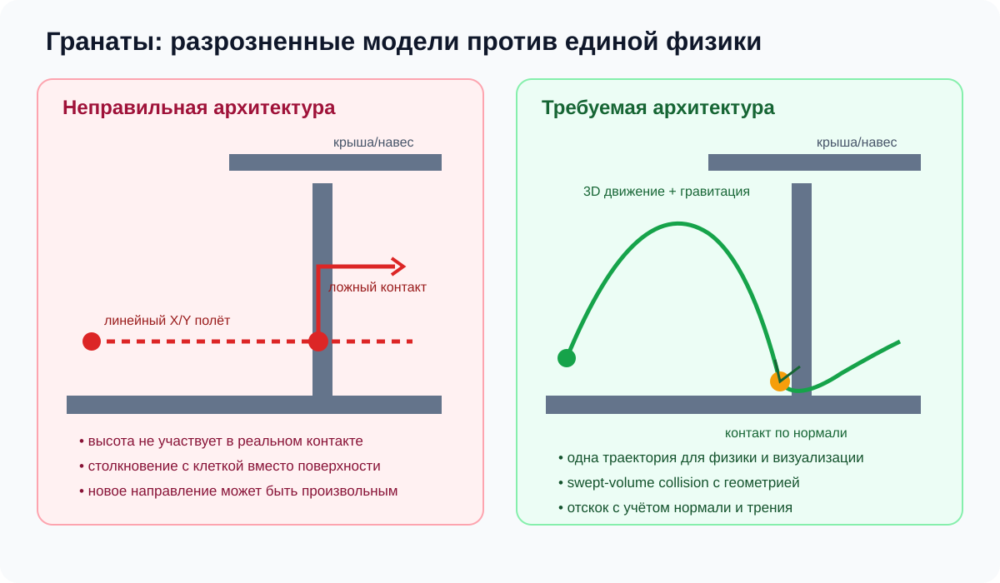

# Расследование физики гранат: предварительные первопричины и безопасный план исправления

**Статус:** статический технический анализ / предложение, не исправление.  
**Исходные симптомы пользователя:**

- Гранаты под стенкой/навесом пропадают или выглядят так, будто взорвались на крыше.
- Гранаты летят не по ожидаемой траектории, хотя в проекте есть 3D-геометрия и заявлялась физика.
- После отскока граната иногда визуально меняет направление примерно на 90°.
- Важно сохранить существующие lineups, целевые точки и поведение других игровых механик.

**Не выполнено:** запуск CS2, запись контрольных бросков, выполнение симуляции и изменение кода. Статический анализ не доказывает причину каждого отдельного увиденного эпизода; для этого нужны воспроизводимый сценарий и трасса столкновений.

## Схема ошибки и целевой модели

## 1. Что необходимо проверить первым

Источники текущей публичной ветки для повторной проверки на commit, который будет выбран для исправления:

- [`src/game/380_nades_throw.js`](https://github.com/xa11mono/sim-cs2/blob/main/src/game/380_nades_throw.js)
- [`src/game/400_nades_physics_damage.js`](https://github.com/xa11mono/sim-cs2/blob/main/src/game/400_nades_physics_damage.js)
- [`src/game/035_map3d.js`](https://github.com/xa11mono/sim-cs2/blob/main/src/game/035_map3d.js)
- [`docs/PROBLEMS.md`](https://github.com/xa11mono/sim-cs2/blob/main/docs/PROBLEMS.md)
- [`docs/tasks/nades_plan.md`](https://github.com/xa11mono/sim-cs2/blob/main/docs/tasks/nades_plan.md)

До изменения нужно зафиксировать commit и перепроверить, что описанные ниже пути всё ещё активны. Номер строки может измениться после обновлений; при ревью ссылаться на функции и фактический commit, а не только на строки из старого отчёта.

## 2. Предварительно обнаруженные архитектурные несоответствия

### 2.1 Проверка броска и фактическое движение могут использовать разные траектории

В просмотренной реализации `380_nades_throw.js` предварительная проверка `nadeArcClear()` учитывает предполагаемую дугу, а в `400_nades_physics_damage.js` ветка полёта `lob` рассчитывает `x/y` через линейную интерполяцию от стартовой к конечной позиции. `arcH`/`sz` присутствуют в параметрах задачи, но нужно проверить, где именно они участвуют в фактическом интегрировании.

**Почему это опасно:** корректность предварительной дуги не гарантирует, что летящая граната пройдёт по этой же дуге. Проверка геометрии и физика исполнения могут противоречить друг другу.

**Что подтвердить при повторной проверке:** активен ли этот путь в текущем commit; какие поля lineup задают исходную скорость/углы; использует ли renderer другую формулу траектории.

### 2.2 Для столкновений может использоваться 2D-проверка вместо 3D-контакта

В просмотренной реализации `nadeWallHit()` вызывает `m3SolidHit(x1, y1, x2, y2)`. По интерфейсу этот вызов передаёт только X/Y. В `035_map3d.js` присутствует и другая 3D-функция пересечения (`m3Hit()`), работающая с геометрией/нормалью, но наличие этой функции не гарантирует, что весь путь гранаты её использует.

**Почему это важно:** 2D-сегмент не содержит высоту полёта. Он не может корректно отличить контакт с полом от пролёта над полом, а также не может самостоятельно проверить крышу на соответствующей высоте. Граница двумерной клетки может ошибочно стать стеной для гранаты.

**Что подтвердить:** точный тип геометрии, используемый активным `m3Hit()`; обеспечивает ли он непрерывный swept-volume контакт, а не пересечение бесконечно тонкого сегмента; не расходятся ли координаты radar/map с world units.

### 2.3 Перенаправление после столкновения может не использовать нормаль поверхности

В просмотренной ветке навесного броска при попадании конечной точки в препятствие граната переносится назад вдоль направления к цели, режим `lob` отключается и задаётся новая скорость из вектора к цели. Это не физическое отражение скорости относительно нормали столкновения.

В другой ветке отражение строится по геометрии, возвращённой `nadeWallHit()`, но если эта геометрия двухмерная, нормаль может не представлять реальную поверхность в 3D.

**Почему это соответствует симптому 90°:** если направление вычисляется из цели или границы клетки, а не из исходного velocity и достоверной normal, возможен визуально резкий и физически неверный разворот. Это правдоподобное причинное объяснение, но конкретный эпизод следует подтвердить логом `position-before`, `velocity-before`, `hitpoint`, `normal`, `velocity-after`.

### 2.4 Ветка «крыша» может удалять гранату по эвристике конечной точки

В просмотренном `nadesTick()` есть отдельная ветка с проверками `nadeCovered(...)` и `nadeArcClear(...)`, которая удаляет гранату из списка полёта, помечает её `onRoof` и добавляет специальный эффект `roof`. Это не равнозначно реальному обнаружению столкновения с крышей; в этой ветке обычный `detonate(n)` не вызывается.

**Почему это может выглядеть как исчезновение/взрыв на крыше:** специальный эффект может представляться визуально как окончание броска, хотя физический контакт с поверхностью не был найден. Проверить нужно и реализацию renderer для `roof: true`; этот документ не делает вывода о конкретной картинке без её проверки.

### 2.5 Случайное смещение цели может ломать точный lineup

В просмотренной `380_nades_throw.js` конечные `tx/ty` могут получать случайное смещение. Если покрытие/линия видимости затем повторно проверяется на смещённую конечную точку, небольшой разброс способен переключить бросок на другую обработку или вывести его за край укрытия.

Сам по себе разброс не обязательно неверен: он может имитировать несовершенное исполнение. Но он должен быть отдельным уровнем skill/error, а не подменять физику. Нужно проверить, различает ли код эталонную траекторию и фактический промах.

## 3. Первопричина на архитектурном уровне

Общий риск — наличие нескольких несогласованных представлений гранаты:

1. планировщик выбирает lineup/цель;
2. проверка допустимости использует предполагаемую дугу;
3. фактическое перемещение может использовать линейную интерполяцию;
4. столкновение может использовать 2D grid;
5. ветка крыши классифицирует результат эвристикой;
6. renderer может показывать отдельный effect path;
7. детонация и повреждение используют конечное состояние, которое могло быть скорректировано обходным путём.

Если это подтверждается в актуальном commit, корневое решение — не очередной patch для крыши или угла, а **единое авторитетное состояние гранаты и единая траектория**, которую используют физика, collision detection, визуализация, эффект и детонация.

## 4. Целевая модель физики

Для каждой гранаты требуется согласованное состояние как минимум:

- позиция `p = (x,y,z)` в единой системе игровых координат;
- скорость `v = (vx,vy,vz)`;
- тип/режим гранаты и время от создания;
- физический размер и параметры поверхности/контакта;
- состояние (in-air, colliding, resting, detonated, expired);
- seed для отдельно моделируемого несовершенства игрока, если оно нужно.

Шаг симуляции должен быть фиксированным и соответствовать модели времени проекта. Интегрирование учитывает гравитацию и скорость. На каждом шаге выполняется проверка **непрерывного движения объёма гранаты** по 3D-геометрии, а не только отрезка одной точки. Это снижает риск tunneling через тонкие поверхности при больших шагах.

При столкновении нужно получить первую точку контакта и корректную нормаль поверхности. Скорость отражается по нормали с подтверждённым коэффициентом восстановления и отдельно учитывает касательное трение/потерю скорости. Эти параметры нельзя угадывать: сначала получить калибровку из настоящих бросков или надёжных игровых данных. Для Source 2 могут быть особенности, которые требуют подстройки модели к измеренному поведению, поэтому простая textbook-модель сама по себе не означает полное совпадение с CS2.

Также необходимо корректно обработать остаток временного шага после столкновения и несколько столкновений за один шаг; иначе углы и стыки могут вызывать застревание, телепортацию или лишний отскок.

## 5. Сохранение существующих lineups

**Не переписывать существующие lineup-данные автоматически.** Сначала нужно классифицировать, что именно хранит каждый lineup:

- стартовая позиция;
- направление взгляда/угол броска;
- сила/режим броска;
- начальная скорость или её derivation;
- целевая точка/область;
- ожидаемый путь контактов (если существует);
- конечная точка и допуск;
- ожидаемое время до срабатывания.

Если lineup содержит только старт и конечную точку, этого недостаточно, чтобы однозначно восстановить историческую траекторию: между двумя точками могут существовать разные дуги и разные пути отскока. В таком случае нужно сначала снять reference throws, либо решать обратную задачу для подтверждённой цели с явной меткой «пересчитанный lineup». Нельзя тихо менять всем броскам угол или скорость ради совпадения конечной точки.

Вводите физическую модель за feature flag или с версией траектории, чтобы сравнить новую модель с текущей на одинаковых seed и сценариях, а затем переключать её осознанно.

## 6. Roof handling должен быть результатом физики

Крыша/навес должна быть обычной 3D-поверхностью в collision world. Граната помечается как попавшая на крышу только после реального обнаруженного контакта с этой поверхностью или иного доказанного события. `covered area` может быть подсказкой для планировщика/диагностики, но не заменой collision event.

Если траектория неожиданно теряется, не скрывайте её как `roof`: сохраняйте гранату активной, фиксируйте ошибку столкновения и создавайте диагностическое событие. Завершение/удаление должно происходить по чётким состояниям: реальная детонация, истечение срока или подтверждённое исчезновение по правилам движка.

## 7. Одна траектория для физики, визуализации и эффекта

Renderer должен читать те же координаты и события, что и физический интегратор. Нельзя рисовать параболу «для красоты», если граната в симуляции движется прямо, или скрывать гранату отдельным декоративным эффектом до подтверждения столкновения.

Каждая траектория для отладки должна иметь overlay:

- начальная позиция и начальная скорость;
- отрезки движения по ticks;
- точка первого контакта;
- normal и материал контакта;
- скорость до/после контакта;
- причина завершения;
- конечная позиция и причина детонации.

## 8. План проверок

| Сценарий | Доказательство, которое нужно получить |
|---|---|
| Свободный бросок без препятствий | Координаты/скорость образуют непрерывную дугу, нет телепортации |
| Бросок под навес | Граната проходит, если вся её объёмная траектория проходит под геометрией |
| Бросок в крышу | Есть зарегистрированный 3D contact с конкретной поверхностью, не просто `covered` heuristic |
| Отскок от пола | Нормаль пола корректна; меняется прежде всего вертикальная скорость по правилам калиброванной модели |
| Отскок от вертикальной стены | отражение соответствует normal и входящей скорости; без произвольного 90° поворота |
| Угол/стык двух поверхностей | стабильный выбор контакта, нет двух конфликтующих отражений и застревания |
| Ступень/наклон | нормаль берётся от реальной поверхности, а не от границы 2D-клетки |
| Ранее существующий lineup | начальная точка и ожидаемый effect/landing остаются в установленном допуске либо lineup явно помечен на повторную калибровку |
| Детерминированный skill seed | физика одинакова при одном seed; поведенческий промах не маскирует collision bug |
| Несколько карт и типов гранат | нет regressions в дыме, флешках, HE и молотовах |

## 9. Что нельзя объявлять доказанным без дальнейших данных

- точные коэффициенты отскока/трения настоящей CS2;
- точную причину конкретного поворота на 90° без трассы контакта;
- точную точку на крыше для исчезнувшей гранаты без координат и collision log;
- совпадение всех существующих lineups с реальным игровым поведением до reference-замеров;
- фактическое текущее состояние кода без фиксации commit, на котором будет выполняться исправление.

## 10. Решение

Если повторная проверка `main` подтвердит описанные разрывы, выполнять исправление в такой последовательности:

1. добавить read-only трассировку траекторий/контактов и сохранить baseline;
2. связать фактическую 3D-траекторию с авторитетным состоянием гранаты, не меняя lineup-файлы;
3. перейти на 3D swept collision с корректной нормалью и устойчивым разрешением контакта;
4. убрать эвристическое завершение броска как замену физическому столкновению с крышей;
5. синхронизировать визуализацию и детонацию с физическим состоянием;
6. калибровать скорость/гравитацию/трение и проверить reference lineups;
7. только после сравнительных тестов включать новую модель по умолчанию.

Никакое изменение не считается готовым только потому, что одна граната теперь падает правильно. Нужны тесты соседних геометрий и сохранения существующих лайнапов.
