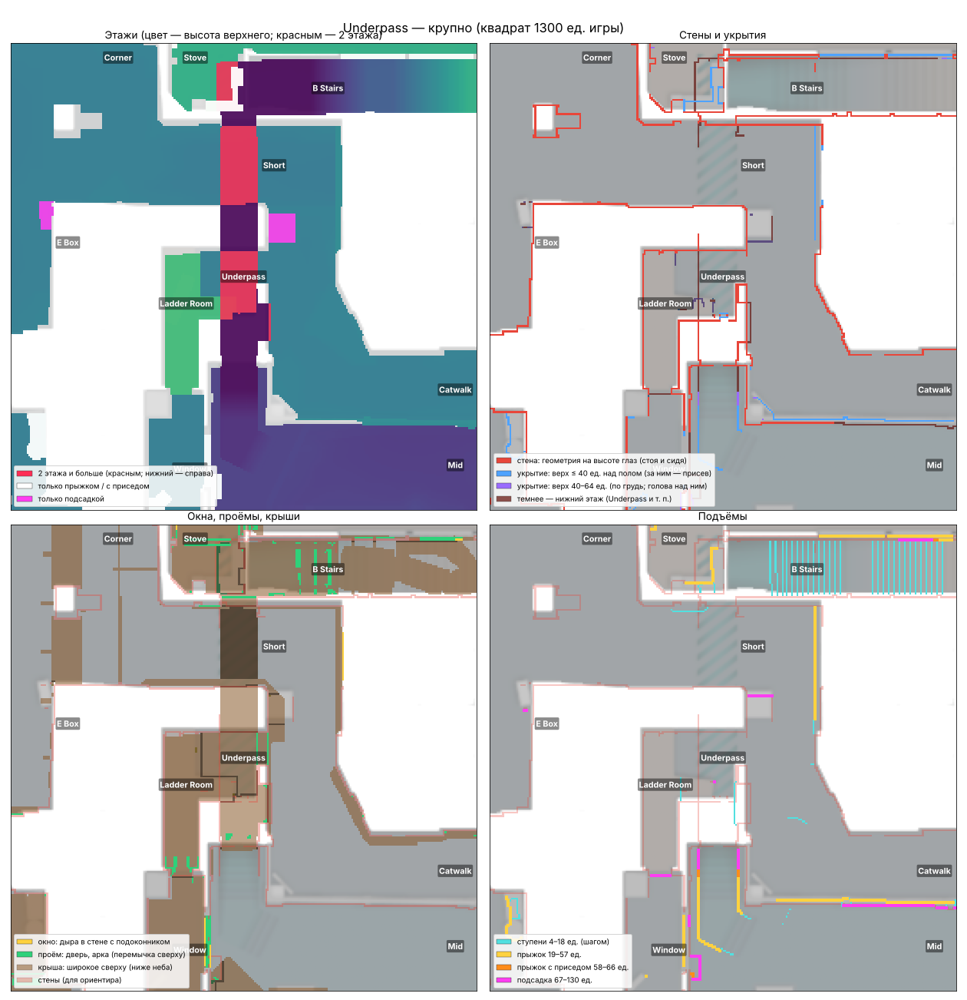
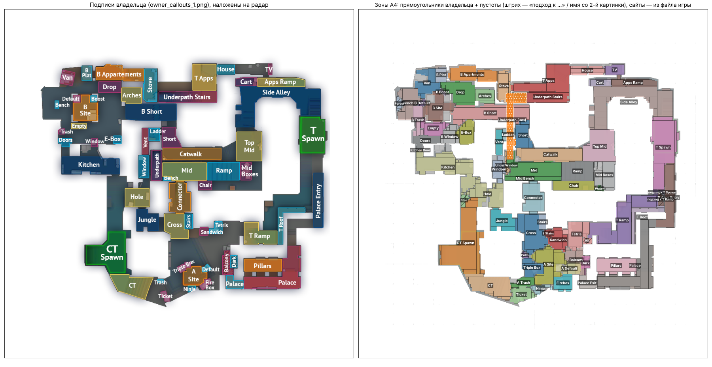
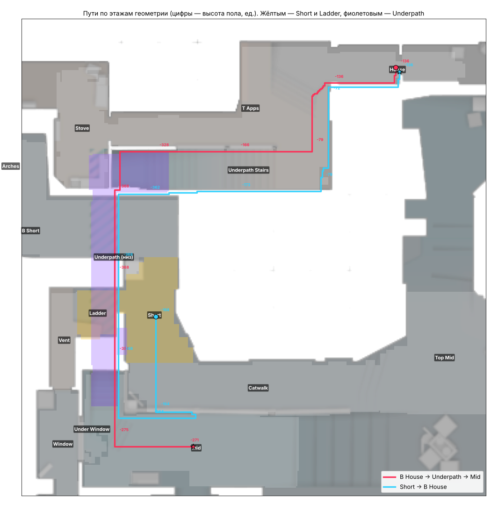

# Карта из 3D-геометрии игры — Mirage (М148)

Шаги А1–А4 общего плана (`docs/PLAN.md`, подробно — `docs/tasks/map3d_plan.md`). Игра не менялась.

## Коротко (20.10.2026)

| что | у про | геометрия игры, вся | **геометрия игры, без служебных слоёв** | наш движок (ENGINE_AUDIT, В1/В8) |
|---|---|---|---|---|
| убийство без прострела, а линия закрыта — **стоя** (глаза 64 → голова / грудь) | 0 % | 17,7 % | **6,0 %** | **23,4 %** |
| …закрыта **всеми лучами** (глаза стоя и сидя → голова, грудь, таз, плечи) | 0 % | 10,5 % | **0,7 %** (47 из 6702) | — |
| пары, 2 с не стрелявшие, глядя друг на друга, а линия есть | ~0 % | 0,8 % | **1,0 %** | 1,6 % |

«Без служебных слоёв» — убраны невидимые стены для игроков (playerclip), стены только для гранат (grenadeclip), «пули проходят»
(passbullets), стекло и сетка. Эти слои теперь известны точно — из служебной части файла карты (А2). Остаток 0,7 % — лучи по кромке
ящиков и проёмов: в демке берётся место жертвы в миг смерти, а не выстрела; Z — по ближайшему тику.

## А1. Проверка геометрии по демкам

**Как.** Все убийства пулей из 72 демок Mirage (как в `tools/measure/engine/demo_prep.py`: XY — `player_death`, Z — ближайший тик).
Луч от глаз убийцы к телу жертвы по треугольникам и выпуклым блокам (`tools/map3d/raycast.py`: сетка 64 × 64 ед. по XY, 0,3–0,6 мс на
луч; что считать стеной — `solid='sight' | 'bullet' | 'all'`). Приседа в наших демках нет (в тиках нет `ducked`), поэтому два счёта:
«стоя» и «все лучи» (2 высоты глаз × 3 точки тела × 3 сдвига вбок — закрыто, только если закрыты все 18).

| | стоя | все лучи |
|---|---|---|
| без прострела, 6702 | 6,0 % | 0,7 % (без прыжков — 0,6 %) |
| прострел (penetrated > 0), 286 | 61 % | 28 % (у остальных пуля пробила, видимо, игрока или мелочь вне геометрии) |

Разница «стоя» 6 % → «все лучи» 0,7 % — это убийства из приседа и по низу тела из-за ящиков и бортиков: видимость в игре (А5) должна
проверять голову, грудь, плечи и присед, а не одну линию «центр → центр».

**Главная находка — невидимые стены.** До разбора А2 на первом месте было окно Market (15 убийств): два блока высотой 85 ед. «закрывали»
стрелков на полу. Разбор файла показал — это **playerclip** (`h623`, `h634`, группа «npcclip, playerclip»): невидимый барьер «не залезть»,
пули и взгляд его не замечают. Ещё важнее: сетка в 8484 треугольника, которую прежний разбор по высоте считал «небом», — тоже
**playerclip** (крышки над картой и невидимые стены вдоль крыш и уступов). Если считать её стеной, «закрыто» растёт до 10,5 %.


### Что осталось «закрыто» (47 убийств, 28 мест) — крупно

`docs/reports/map3d/los_zoom_1…8.png`: слева — сверху (цвет — высота верха), справа — разрез по лучу (человечки, линия глаз, красным —
что закрывает).

| # | место | убийств | что закрывает (материал) | на что похоже |
|---|---|---|---|---|
| 1 | Boost / мид (−838, −508) | 8 | длинная тонкая стенка у края уступа | бортик: луч идёт вниз по самой кромке, подъём глаз на 8–16 ед. открывает — позиция / присед на краю |
| 2 | Window (мид) | 3 | рама / подоконник окна | поза в окне (стоит на подоконнике) |
| 3 | Shadow | 2 | стена | край стены |
| 4 | B Apps | 2 | пол / перекрытие | Z из тиков не того этажа |
| 5, 7 | Connector | 2 + 2 | стойки 5 × 36 × 137 ед. (бетон) | луч чиркает по стойке проёма |
| 6 | T Ramp | 2 | угол боковой стенки лестницы | позиция в миг смерти |
| 8 | Ticket | 2 | стена | край |

Это уже не ошибки геометрии, а точность данных демок (место смерти, а не выстрела; нет приседа; Z ±16 тиков).

## А2. Служебная часть файла (KV3) — разобрана

`tools/map3d/kv3.py` — разбор двоичного KV3 v2–v5 (zstd, LZ4, без сжатия; устройство — по ValveResourceFormat, MIT), имена — по хешу
MurmurHash2, как в игре (`tools/map3d/known_strings.json`). `tools/map3d/vpk_physics.py` переписан на него (вместо поиска блобов по
размерам): **геометрия совпала с прежней бит в бит** (все 9 массивов), к ней добавлены группа и материал у каждого треугольника и блока.

**Группы столкновений Mirage** (`attr_json` в `world_physics.npz`, сводка — `data/maps/mirage/geom3d/phys_attrs.json`):

| группа | «чем является» | треугольников | блоков | что это | для взгляда / пуль |
|---|---|---|---|---|---|
| 0 | (обычная) | 86 417 | 1856 | стены, полы, ящики | стена |
| 1 | passbullets | — | 71 | металл (по виду — решётки, перила) | пули и взгляд проходят |
| 2 | playerclip, npcclip | **8 484** | 5 | невидимые стены для игроков, крышки над картой | **не стена** |
| 3 | (обычная, кроме игроков) | 420 | 1 | вентиляция, мелочь — игроки проходят | стена для пуль |
| 4 | ladder, playerclip | 2 | — | лестница | не стена |
| 5 | csgo_grenadeclip | 950 | — | стены только для гранат | не стена (для гранат — стена, шаг В2) |
| 6 | passbullets, window | 4 | — | окно (сетка `chainlink`) | не стена |
| 7 | ladder, passbullets | 2 | — | деревянная лестница | не стена |
| 8 | sky | 76 | — | небо | не стена (гранаты отскакивают) |

Прежний признак неба («выше 900 и шире 3000 ед.») забирал в небо и playerclip — теперь небо берётся по тегу `sky`, а playerclip лежит в
сетках с группой 2. **Тем, кто читает `world_physics.npz`: фильтровать по `mesh_attr` / `hull_attr`** (`raycast.solid_mask`).

**Материалы** (40, все имена найдены): больше всего — concrete (35,9 тыс. треуг.), plaster (24,7 тыс.), rock, wood, wood_plank, sand,
brick, tile; блоки — concrete, metal, rock, wood_plank, wood_panel, cardboard; стекло (11 блоков) и сетка `chainlink`. Это вход для
прострелов: пробиваемость по материалу и толщине.

**Прострелы про по материалам** (`tools/map3d/wallbang_demo.py` → `data/maps/mirage/geom3d/wallbang_demo.json`): из 221 прострела сквозь
геометрию первая пробитая поверхность — дерево у **114** (wood 53, wood_plank 46, wood_solid 15), бетон 36 (кромки, толщина 20–30 ед.),
plaster 29, rock 18, вентиляция 6, картон 6. Толщина пробитого — медиана 6 ед., 90 % — до 24 ед. Места: Shadow (21 + 13 + 6, дерево),
Triple Box (17 + 10, дерево), Default (14, wood_solid / металл), Ticket (13), Firebox (7).


**Сущности** (`tools/map3d/vpk_entities.py` → `data/maps/mirage/geom3d/entities.json`, 561 сущность):
- спавны: T — 17, CT — 16 (с приоритетом; совпадают с отметками спавнов в `de_mirage.txt`);
- зоны закладки: **A** — коробка (−616, −2328) … (−264, −1972), радар (1046…1186, 1474…1616); **B** — (−2216, 72) … (−1880, 440), радар
  (406…540, 509…656) — точно, не на глаз;
- зоны закупки T / CT; `solid_entities` — 147 предметов со своей физикой (горшки, шлакоблоки, банки, стулья, вентиляторы) — для А3.

## А3. Слои карты из геометрии (20.10.2026, игра не менялась)

**Как устроено.** Геометрия (без невидимых стен для пуль и взгляда) разложена в «столбики» на сетке VIS — клетка 5 ед., в каждой —
занятые высоты (`tools/map3d/columns.py`); из них — этажи и слои (`layers.py`); для игры — `geom3d/map3d.json`, устройство и луч —
`docs/ARCHITECTURE.md`, «Карта 3D». Луч образцом игры (`tools/map3d/map3d.js` в node) по тем же 6702 убийствам про:

| | А1 (треугольники, python) | **map3d.json (образец игры)** | только столбики 5 ед. | только столбики 2,5 ед. |
|---|---|---|---|---|
| закрыто стоя | 6,0 % | **6,0 %** | 17,2 % | 11,2 % |
| закрыто всеми лучами | 0,7 % | **0,7 %** | 6,5 % | 2,9 % |
| пары «смотрели и не стреляли», линия есть | 1,0 % | **1,0 %** | — | — |

Столбики «с запасом» (геометрия, задевшая клетку краем, занимает её всю) — поэтому одни они закрывают лишнее; они — быстрый отсев
(«свободно» по ним верно всегда: 0 ошибок на 26 964 лучах), а где задели — точная проверка треугольников рядом. ≈ 8 мкс на луч.

| слой | что получилось | картинка |
|---|---|---|
| **этажи** | 285 тыс. клеток пола (5 × 5 ед.); 2 этажа и больше — 4,2 тыс. (Underpath под Short, Shadow под балконом); пешком 275 тыс. этажей, только прыжком 11 тыс. (ящики, уступы), только подсадкой 3 тыс.; под навмешем `.nav` этаж есть на 98,7 % площади | `a3_floors.png` |
| **стены** | геометрия на высоте глаз (64), начинается не выше глаз присевшего — 14,2 тыс. клеток (от каждого этажа; нижний этаж — темнее) | `a3_walls.png` |
| **укрытия с верхом** | на высоте глаз пусто, ниже — верх 18–64 ед. над полом: 3,5 тыс. (из них по пояс ≤ 40 ед. — 2,1 тыс.) | `a3_walls.png` |
| **окна / проёмы** | дыра в стене: перемычка узкая поперёк и доходит до косяков (≤ 150 ед.); с подоконником — окно (261 клетка: Window мид, окна B Apps, Market), без — проём (4,6 тыс.: двери, арки Palace, входы) | `a3_openings.png` |
| **крыши** | сверху широкое ниже неба: 88 тыс. клеток (Market, B Apps, Palace, Connector, Jungle, Underpath, T Ramp…) | `a3_openings.png` |
| **подъёмы** | ступени 4–18 ед. — 4,4 тыс. переходов; прыжок 19–57 — 2 тыс.; с приседом 58–66 — 127; подсадка 67–130 — 911 | `a3_climbs.png` |
| **небо** | потолок неба над игровыми местами ≈ 500 (CT) … 900 ед. — гранаты отскакивают, взгляд и пули не замечают | `a3_sky_wallbang.png` |
| **прострелы** | стена на высоте глаз: материал + толщина (до другой стороны): тонких ≤ 32 ед. из дерева / штукатурки / тонкого металла — 6,8 тыс., из бетона / камня — 7,2 тыс.; поверх — места прострелов про (А2) | `a3_sky_wallbang.png` |

Крупно (все 4 слоя на одной картинке): `a3_zoom_b_apps.png`, `a3_zoom_underpass.png`, `a3_zoom_a_site.png`.



**Числа подъёмов.** Шаг 18 (CS: `sv_stepsize`); прыжок — **57 ед.** по физике CS2 (импульс 301,99, гравитация 800: v²/2g), а не 64, как
`JUMP_UP` в игре и в плане; с приседом — 66 (ноги в воздухе выше на 9); подсадка 130 (72 роста + прыжок) — **проектное число**.
Лестницы (ladder) в геометрии — только невидимая стена, переходы по ним взяты из навмеша `.nav`.

**Навмеш.** Ходьба — по `de_mirage.nav` (уже в наборе, версия 36). `.vpk` у владельца, к его компьютеру в этом чате доступа не было —
сверить, что `.nav` в наборе тот же, что в этом `.vpk`, не смог; по форме совпадает: под навмешем этаж геометрии есть на 98,7 % площади,
обратное — 80 % (остальное — углы у стен, куда навмеш не доходит, верх ящиков).

**Что не так / под вопросом.** Окна, проёмы и крыши — по правилу «узкая перемычка до косяков», балки в комнатах иногда дают крошечные
«проёмы»; толщина стены для прострелов — по клеткам 5 ед. (грубо); 147 предметов со своей физикой (горшки, шлакоблоки, банки — А2)
в геометрии мира нет — в слоях их нет (в игре они двигаются от выстрелов).

## А4. Зоны по подписям владельца (20.10.2026)

`tools/map3d/zones_owner.py` → `geom3d/zones_owner.json`, картинка `a4_zones.png` (слева — подписи владельца, наложенные на радар;
справа — зоны). **69 зон:** 61 прямоугольник с первой картинки (переписан по пикселям; совмещение с радаром по силуэту карты — 0,93),
сайты A и B — коробками закладки из файла игры (точно); пустоты между ними — прямоугольники растут навстречу друг другу по клетке за круг
(зоны остаются ровными), остаток — ближайшей зоне по ходьбе; места, которые подписывает только вторая картинка, — свои зоны: **Forest,
Palm, 90, Water, Stair** (спуск от Hole к CT), **E Stairs, Under Window, Kitchen Door**. Ничего не осталось без зоны, «подход к …» не
понадобился (всё дальше 400 ед. от подписей закрылось ростом).
Повторяющиеся названия разведены: Default → **B Default / A Default**, Trash → **B Trash / A Trash**, Window (Market) → **B Window**,
Bench у мида → **Mid Bench**, малый Palace у Balcony → **Palace Exit**; Underpath — зона нижнего этажа (над ним — Short / Window).



## Пути: B House → Underpath → Mid, Short → B House (владелец 20.10)

`tools/map3d/route.py` → `geom3d/route_check.json`, картинка `route_bhouse_mid.png`. Ходьба — по этажам геометрии: шаг ≤ 18, спрыгнуть,
прыжок, лестница (подсадку в путь не берём — нужен второй игрок).
- **B House → Underpath → Mid** (2865 ед.): House → T Apps → Underpath Stairs (вниз −79 … −295) → Underpath (−298 … −368) → Mid (−271).
  Это и кратчайший путь House → Mid без всяких условий.
- **Из Underpath на Short и на Ladder попасть нельзя**: ни шагом, ни прыжком, ни подсадкой, ни лестницей. Выходов из Underpath только
  два: в Mid и на Underpath Stairs. Ещё есть уступ к Under Window, но туда только прыжком или подсадкой. Лестница (ladder) на Mirage
  одна: Ladder Room ↔ уровень Short (−56 ↔ −164), в Underpath её нет.
- **Short → B House** (3305 ед.): Short → Catwalk → Mid → Underpath → Underpath Stairs → T Apps → House. Прямого хода с Short в B House
  нет. Без Underpath — через Top Mid, Side Alley, Apps Ramp, TV (3675 ед.).
- **Исправлено в зонах:** раньше тоннель под Short и Ladder (−368) получал имена зон сверху. На этом месте проверка «из Underpath можно
  на Short» ложно давала «можно». Теперь нижняя зона забирает весь свой этаж и выше него не растёт; зоны растут только шагом.



## Как повторить

```
python3 tools/measure/engine/demo_prep.py --map mirage      # данные демок (≈ 10 мин)
python3 tools/map3d/vpk_physics.py <de_mirage.vpk> mirage   # геометрия + группы + материалы → world_physics.npz, phys_attrs.json
python3 tools/map3d/vpk_entities.py <de_mirage.vpk> mirage  # спавны, зоны закладки → entities.json
python3 tools/map3d/los_check.py --map mirage [--solid=all] # А1: лучи (≈ 2,5 мин) → tools/measure/runs/map3d/mirage_los[_all].json
python3 tools/map3d/los_pics.py --map mirage                # картинки los_*.png, phys_layers.png
python3 tools/map3d/wallbang_demo.py --map mirage           # прострелы по демкам и материалам
python3 tools/map3d/columns.py --map mirage                 # А3: столбики (≈ 80 с) → geom3d/columns.npz
python3 tools/map3d/layers.py --map mirage                  # А3: этажи и слои → layers.npz, map3d.json (для игры)
python3 tools/map3d/layer_pics.py --map mirage              # А3: картинки a3_*.png
node tools/map3d/map3d_check.js mirage                      # А3: проверка map3d.json образцом игры по убийствам демок
python3 tools/map3d/los_columns.py --map mirage             # А3: то же одними столбиками (насколько они «с запасом»)
python3 tools/map3d/zones_owner.py --map mirage             # А4: зоны → zones_owner.json, a4_zones.png
python3 tools/map3d/route.py --map mirage                   # пути B House → Underpath → Mid, Short → B House; выходы из Underpath
```
