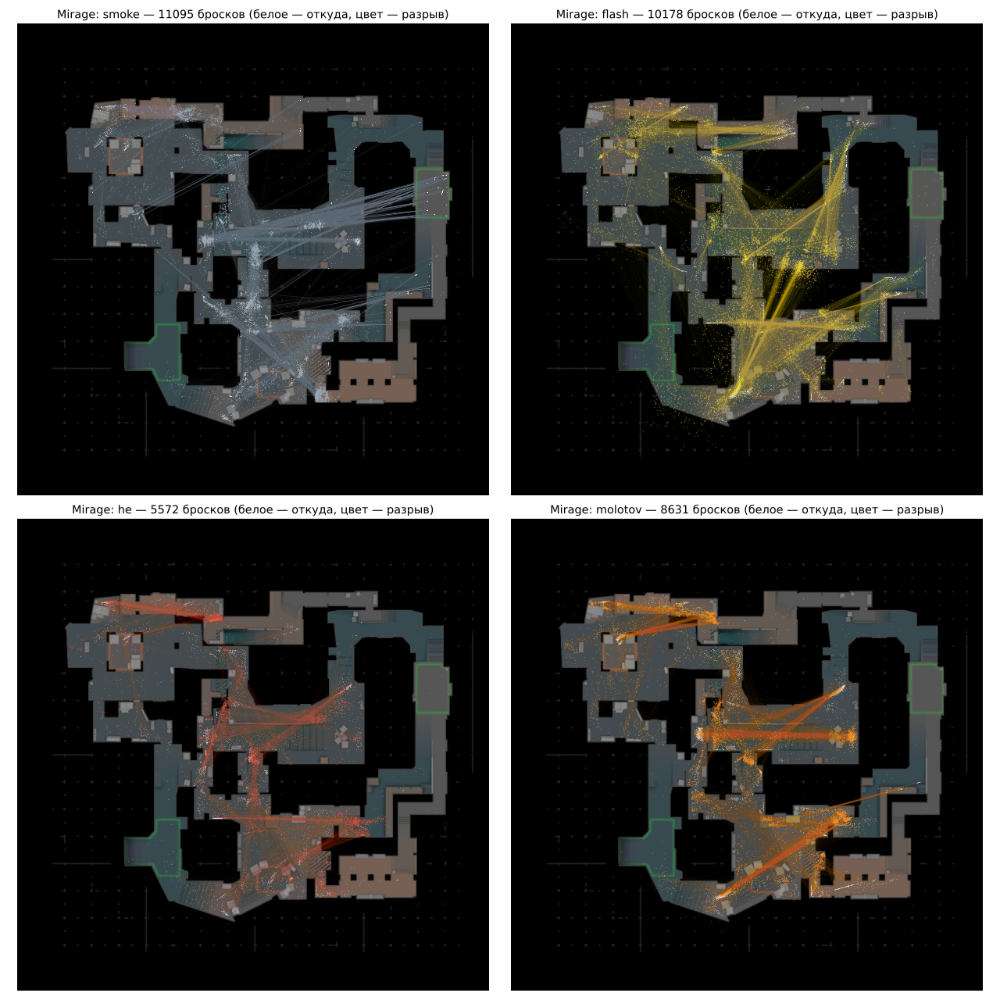
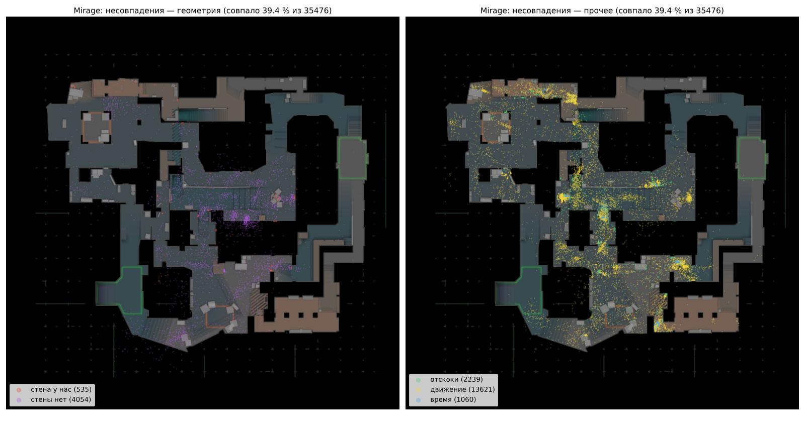

# Гранаты: броски про и физика полёта — В1–В3, В2б (М138), 21.10.2026

Игра не менялась, матчи не гонялись: только данные из демок и разбор. Статус — **ждёт проверки владельца**.

Что получилось одной фразой: все броски про обеих карт выгружены и связаны с разрывом (99,2–99,3 %); физика гранаты собрана
одним модулем и проверена на 75 тыс. бросков — **флешки, HE и молотовы, кинутые стоя, она повторяет в 57–71 % случаев (точка
≤ 32 ед., время ≤ 0,25 с), повторяемые лайнапы флешек / HE — 70–93 %; смоки — только 23–42 %; на ходу — 31–46 %**: смок прыгает
по полу 4–6 раз, и малейшая разница уводит его. Числа физики из исходников CS:GO подтвердились демками почти все; в CS2
по-другому только вертикаль от прыжка и задержка вылета.

Файлы: броски — `data/maps/<карта>/throws.json`; модуль физики — `src/game/385_nades_flight.js` (до В3 — `src/nadephys.js`);
скрипты — `tools/nades/` (`throws.py` → `check.js --fuse --fill` → `report.py`); картинки и сводка —
`docs/reports/nades/`.

---

## В1. Броски про из демок

**Источник.** `weapon_fire_full` (выгрузка Б4) — бросок: тик, место ног X/Y/Z, поворот, наклон, скорость игрока по трём осям,
присед. Разрывы — `flashbang_detonate`, `hegrenade_detonate`, `smokegrenade_detonate`, `inferno_startburn` (x, y, z, тик,
кто бросил, entityid). Раунды — `tools/demos.py` (конец закупки … конец раунда, переигранные отброшены).

**Демки.** Ancient — 80 с `weapon_fire_full` (в задании было 79; без него — 12, не взяты: astralis-vs-gamerlegion,
falcons-vs-g2-m3, g2-vs-falcons-m1, gamerlegion-vs-astralis-m2, liquid-vs-astralis-m2, luminosity-vs-spirit-m1 p1/p2, mouz-vs-fut-m1,
natus-vincere-vs-gamerlegion-m2 p1/p2, parivision-vs-g2-m3, the-mongolz-vs-betboom-m3). Mirage — 85 (без выгрузки одна:
marsborne-vs-without-a-roof-m4 — в выборку не входит).

**Связь бросок → разрыв.** Тот же игрок, тот же тип, тот же раунд, первый ещё не занятый разрыв после броска в окне (флешка /
HE — 3 с, молотов — 4 с, смок — 15 с). entityid у броска в выгрузке нет, им связать нельзя; проверено, что ни один разрыв не
достался двум броскам (0 двойных).

| | Ancient | Mirage |
|---|---|---|
| бросков в раундах (без декоев) | 39 870 | 35 709 |
| связано с разрывом | **39 542 (99,2 %)** | **35 476 (99,3 %)** |
| смок / флешка / HE связано | 11 303 из 11 306 / 11 496 из 11 499 / 7 490 из 7 494 | 11 095 из 11 096 / 10 178 из 10 182 / 5 572 из 5 574 |
| молотов связано | 9 253 из 9 571 (96,7 %) | 8 631 из 8 857 (97,4 %) |
| не связано (отдельно) | 328: молотовы 318, прочие 10 | 233: молотовы 226, прочие 7 |
| разрывов без броска | 14 | 14 |
| бросков вне раунда (не взяты) / декоев | 103 / 63 | 83 / 39 |

Несвязанные молотовы — те, у которых не было `inferno_startburn`: вероятно, упали в смок (гаснут без огня) или разорвались
над пустотой (в `throws.json` у них `det: null`).

**Поля броска** (`throws.json → throws[]`): карта (файл), демка, раунд, сторона, тип, место ног `pos`, поворот `yaw`, наклон
`pitch`, присед `duck`, скорость игрока `vel` и `hspeed`, `move` — стоял / шёл (до 160 ед/с) / бежал / прыжок (|vz| > 60);
разрыв `det` — тик, через сколько секунд, точка, entityid. Сила броска `strength` (1 ЛКМ, 0,5 обе, 0 ПКМ) и `jumpBind`
(прыжок на бинде) заполнены после В2 — только у бросков, которые физика повторила; у остальных `null`.

| как кидали | Ancient | Mirage |
|---|---|---|
| стоял | 9 393 | 9 991 |
| шёл | 9 959 | 10 028 |
| бежал | 12 682 | 11 139 |
| в прыжке (видно по скорости) | 7 836 | 4 551 |
| присев | 62 | 119 |

Картинки «откуда → куда» по типам: `nades/v1_ancient_throws.png`, `nades/v1_mirage_throws.png` (белое — откуда, цвет — разрыв).



**Что видно по времени разрыва (это вошло в физику):**
- флешка и HE рвутся через **110–111 тиков** после броска у 89–91 % и через **117–118** у 9–11 % (остальное — 0,1 %). Разница
  ровно 7 тиков — граната вышла позже (бросок сразу после взятия гранаты), а не горела дольше: если считать это запалом, такие
  броски промахиваются все (0 % в пределах 25 ед.), если задержкой вылета — как остальные;
- молотов, не коснувшийся пола, рвётся через 135–136 тиков (2 с полёта + задержка вылета);
- один и тот же лайнап у про повторяется почти точно: разброс точки разрыва при одном месте и прицеле (±6 ед., ±0,3°) —
  медиана 2–7 ед., 90 % — до 10 ед. у флешек / HE / молотовов, до 23–79 ед. у смоков (они катятся); время — до 0,02 с,
  у смоков до 0,1–0,7 с. Игра детерминирована — значит, ошибка больше этого у нас — наша.

---

## В2. Физика гранаты

### Что видит граната (проверено)
Геометрия — та же, что для взгляда (А3 / А6: `world_physics.npz` из `.vpk`), но с маской для гранаты. Проверка — доля бросков
про ≤ 25 ед. на выборке каждого 10-го броска при разных масках:

| что считать стеной для гранаты | Mirage | Ancient | вывод |
|---|---|---|---|
| обычная геометрия + grenadeclip + решётки, окна, небо (принято) | 34,9 % | 38,1 % | — |
| + playerclip (невидимые стены для игроков) | 23,8 % | 12,4 % | **граната сквозь playerclip пролетает** |
| без csgo_grenadeclip (стены только для гранат) | 34,8 % | 37,7 % | **grenadeclip её останавливает** (на Mirage их почти не касаются) |
| + группы с исключением `csgo_thrown_grenade` (детали) | (таких нет) | 36,3 % | **сквозь них пролетает** |

Небо: у Mirage есть потолок-небо (76 треугольников) — граната от него отскакивает (вошло); у Ancient неба в файле столкновений
нет — выше карты граната летит свободно. Лестницы (ladder) — не стена.

### Числа физики
Устройство полёта — исходники CS:GO (бросок `ThrowGrenade`, полёт `PhysicsToss` / `PhysicsAddGravityMove` — средняя скорость за
тик, отскок `ResolveFlyCollisionCustom`, молотов). Публичной ссылки на сам код CS:GO нет (общий движок — Source SDK 2013,
`ValveSoftware/source-sdk-2013`, ссылку в этом чате открыть не удалось); поэтому **каждое число проверено бросками про**:
подгонкой по точке и времени разрыва. Как проверял: свободный полёт (без касаний) флешек / HE, кинутых стоя, считается
формулой — подгонка всех чисел сразу неоднозначна (скорость, тяжесть и время полёта меняются друг за другом), но с числами
исходников (675, 320, наклон +10) остальные выходят сами: глаза 63 ед. (в CS2 — 64), точка вылета 16 ед. перед глазами (как в
исходниках), ошибка — медиана 5 ед. (как разброс у самих про).

| число | значение | откуда |
|---|---|---|
| тяжесть | 320 ед/с² (800 × 0,4) | исходники; демки подтверждают |
| скорость броска | 750 × 0,9 = 675 ед/с | исходники; демки подтверждают (подгонка 682–697) |
| сила | × (0,3 + 0,7 × сила): ЛКМ 1, обе 0,5, ПКМ 0 | исходники; в демке силы нет — подбирается по точке разрыва |
| наклон | поднимается на (90 − |наклон|) × 10/90 | исходники; демки 9,9–10,4 |
| откуда вылетает | глаза (стоя 64,06, присев 46,04), ниже на 12 × (1 − сила), 16 ед. вперёд (у стены — ближе) | исходники; демки |
| скорость игрока | по горизонтали × 1,25 | исходники; демки 1,19–1,28 |
| прыжок на бинде | +302 вверх (сила прыжка); в демке не виден — скорость в тик броска ещё без прыжка | **демки** (подгонка 300–302) |
| бросок уже в прыжке | +272 вверх, от скорости игрока не зависит | **демки, проектное число** (270–273; «× скорость» — хуже) |
| падение / скаты | 0 | **демки** (подгонка −0,03…−0,09) |
| задержка вылета | 6,3 тика после броска (+7 у 9–11 % флешек / HE — из времени разрыва) | **демки** |
| отскок | отражение × 0,45, медленнее 30 ед/с — стоп; «пол» — нормаль > 0,7 | исходники; демки 0,44–0,49 и 29–37 |
| флешка / HE | рвутся по запалу 1,627 с от вылета (в т. ч. в воздухе) | **демки** (110,4 − 6,3 тика) |
| молотов | касание пола не круче 30° — разрыв; от стен отскакивает; не коснулся за 2 с — разрыв в воздухе, огонь — на пол под ним | исходники (2 с, 30°); демки (135–136 тиков) |
| смок | разрыв, когда остановился | исходники |

Пробовал и не взял (не улучшают ни на одной карте): отдельная упругость вдоль поверхности (0,41–0,43 — то же, что 0,45),
упругость по материалу (подгонка 0,9–1,0), отступ от поверхности после удара 1–2 ед. вместо 0,05 (как будто у гранаты
есть размер).

### Пороги совпадения: N = 32 ед., M = 0,25 с
Выбраны после первого замера: (1) разброс одного лайнапа у самих про — 90 % в пределах 5–10 ед. у флешек / HE / молотовов и до
23–79 ед. у смоков; 32 ед. — втрое больше разброса флешек и закрывает основную часть смоков; (2) 32 ед. — ширина игрока: точка в
этих пределах для смока / молотова — то же место на карте (радиус дыма ≈ 144 ед.). Время: у про один лайнап по времени — до
0,02 с (смоки — до 0,1–0,7 с); 0,25 с — меньше реакции человека на флешку. Для сравнения в сводке есть и ≤ 16 / ≤ 64 ед.

### Проверка: доля бросков про, которые физика повторяет
Каждый бросок — через физику с тремя силами (и для бросков с земли — с прыжком на бинде и без), берётся лучший вариант.

| | Ancient | Mirage |
|---|---|---|
| **все броски** (совпало: место ≤ 32 и время ≤ 0,25 с) | **42,5 %** из 39 542 | **39,4 %** из 35 476 |
| место ≤ 16 / ≤ 32 / ≤ 64 ед. | 26,4 / 45,3 / 63,2 % | 22,6 / 42,4 / 62,4 % |
| смок | 25,5 % (место 34,8, время 42,7) | 34,0 % (место 43,1, время 53,4) |
| флешка | 53,1 % | 44,3 % |
| HE | 49,4 % | 41,0 % |
| молотов | 44,8 % (время 87 %) | 39,4 % (время 90 %) |

По тому, как кидали (совпало, %):

| | смок | флешка | HE | молотов |
|---|---|---|---|---|
| Ancient, стоял | 33,2 | **71,1** | **67,3** | **67,2** |
| Ancient, прыжок | 30,3 | **76,9** | 50,0 | 54,3 |
| Ancient, шёл / бежал | 16,2 | 33,7 | 46,1 | 39,3 |
| Mirage, стоял | 41,9 | **67,6** | **62,0** | 56,7 |
| Mirage, прыжок | 16,6 | 56,1 | 54,8 | 17,5 |
| Mirage, шёл / бежал | 32,4 | 30,7 | 34,1 | 37,8 |

**Лайнапы** (один и тот же бросок — то же место ±6 ед., прицел ±0,3°, стоя или в прыжке — не меньше 3 раз в демках):
Ancient — 526 лайнапов, 3 096 бросков, совпало 37,1 % (смок 23,0, флешка **92,5**, HE **79,2**, молотов **87,2**);
Mirage — 535 лайнапов, 3 639 бросков, совпало 28,6 % (смок 23,8, флешка **85,9**, HE **70,5**, молотов 39,6).

Подобранная сила у совпавших: ЛКМ — 86–90 %, обе — 4–10 %, ПКМ — около 5 %; прыжок на бинде — у 9–14 % совпавших.
Время у флешки / HE совпадает по построению (запал постоянный, задержка вылета — из времени разрыва); у молотова — сама физика
(медиана ошибки 0,03 с), у смока — медиана 0,22–0,33 с (у совпавших по месту — ±0,1 с).

### Где не совпало и почему
Картинки — `nades/v2_ancient_misses.png`, `nades/v2_mirage_misses.png` (слева — геометрия, справа — прочее).



| причина (первая подошедшая) | Ancient | Mirage |
|---|---|---|
| **движение** — кидал на ходу / в прыжке (скорость в тик броска и миг прыжка видны в демке неточно) | 15 697 (69 %) | 13 621 (63 %) |
| **стены нет** — у нас граната пролетела без касаний, у про — нет: ударилась о то, чего у нас нет (игрок, дверь, мелкая геометрия) | 4 012 (18 %) | 4 054 (19 %) |
| **отскоки** — оба ударились, цепочка отскоков / качение по полу разошлись (ступени, края, скаты) | 1 533 (7 %) | 2 239 (10 %) |
| **время** — место совпало, смок докатился не тогда | 1 103 (5 %) | 1 060 (5 %) |
| **стена у нас** — у нас удар о стену / небо, а разрыв про лежит на дуге без стен: лишняя стена / край не там | 373 (2 %) | 535 (2,5 %) |

Места «стена у нас» (чаще всего): Ancient — Lower Mid (26), Snake (14), Cat Walk (10), Tree (10), Temple (9); Mirage — T Ramp
(25), Cart (42), Mid Boxes (19), Car (25), Connector (12), Stove (10). Их мало — геометрия для гранат в целом верная.

Смоки — главное, что не получилось. Пример: смок Window (Mirage) у нас падает на пол окна и останавливается на ≈ 35 ед. раньше,
чем у про; смок в мид с T-спавна (Ancient, 65 повторов) после первого касания у нас прыгает дальше и останавливается на 300 ед. дальше,
чем у про.
Правки отскока (вдоль поверхности, по материалу) это не лечат — значит, разница в форме пола (ступени и края в файле
столкновений против того, что «видит» граната CS2) или в том, как CS2 катит гранату. Это следующий кандидат на разбор (до В4:
лайнап = записанный бросок — для смоков нужна точность лучше 23 %).

### Что нужно В3 (полёт в игре) — *поправка 21.10, В3*
В В2 здесь было написано, что в `map3d.json` игры нет нормалей, неба и grenadeclip, — **это было неверно**: в нём уже есть точная
геометрия (треугольники и блоки с меткой «для гранат», материалы, небо по клеткам), и луч гранаты с нормалью (`m3Hit`). В В3 физика
идёт по ней (`m3NadeTrace`); проверка бросками про на этой геометрии дала то же, что в В2 (Mirage 34,9 %, Ancient 38,2 % ≤ 25 ед. на
каждом 10-м броске). Одна правка: у Ancient детали «кроме брошенной гранаты» (239 тыс. треугольников) больше не считаются для гранаты.

---

## В3. Полёт в игре по физике (v391) — *ждёт проверки владельца*

**Что сделано.** Граната в игре летит по физике В2 (`src/game/385_nades_flight.js`) по геометрии игры (`map3d.json`, луч
`m3NadeTrace`): дуга, отскоки от пола / ступеней / стен / крыш / неба, флешка и HE — по запалу (в т. ч. в воздухе), молотов —
о пол или через 2 с в воздухе, смок — когда остановился. Бот кидает как человек: поворот на цель, наклон и сила (ЛКМ / обе / ПКМ)
подбираются настоящим полётом (`nadeAim`: наклон × сила → прыжок на бинде → с разбега и прыжком → поворот вбок). Долетит ли —
решает физика: своя граната кидается, если ложится ближе 100 ед. к цели (флешка — 200), лайнап — лучшим броском (если ближе 400).
На радаре — тень гранаты на земле, сама граната выше на свою высоту, след дуги и крестик «куда упадёт».

**Удалено взамен:** прямой навес «по прямой за заданное время сквозь всё», «телепорт» гранаты от стены, отскок от стен радара,
`nadeArc` (дуги под потолками), `nadeTallWall` (сквозь стену — только как про), `nadeCovered`; `MAP.nadelanes` — теперь только
«откуда можно кинуть», а не разрешение. Геометрия Ancient: граната больше не задевает детали, через которые в игре пролетает
(239 тыс. треугольников, видимость не изменилась — бит в бит). Смок / молотов, легший на крышу (выше 120 ед. над полом, куда
можно дойти), не действует на тех, кто под ней; HE рвётся и в воздухе, урон — с учётом высоты.

**Насколько прицел попадает (без матчей):** из места, откуда кидал про, в точку его разрыва — 79 % ближе 32 ед., 94 % ближе
100 ед. (Ancient, броски стоя); лайнапы набора — 64–100 % ближе 100 ед. по типам. Решение — ≈ 12 мс на бросок (кэшируется), скорость
игры та же (3 раунда — 100–150 с и у базы, и у правки; прогон ПК — 13–14 мин, как у базы).

**Прогоны на ПК** (база — v390, та же игра, что main до В3; правка — v391), сначала 8 матчей на карту, решение — на 16:

| цифра | Ancient: было → стало | Mirage: было → стало |
|---|---|---|
| гранат за раунд CT | 9,22 → 9,18 (−0,4 %) | 8,68 → 8,15 (−6,1 %) |
| гранат за раунд T | 11,31 → 10,47 (−7,4 %) | 9,76 → 9,14 (−6,4 %) |
| `stall` | 2466 → 2470 (0 %) | 2359 → 2244 (−4,9 %) |
| `nav` | 27,2 → 23,1 (шум) | 141,6 → 148,8 (+5 %) |
| `tug` | 95,6 → 103,7 (+8,6 %) | 47,4 → 39,9 (шум) |
| `danger` (флешка без реакции, стоит в огне, в зоне взрыва) | **165,8 → 113,2 (−32 %)** | **128,8 → 107,6 (−17 %)** |
| доля раундов T / с плантом | 0,57 → 0,52 / 0,61 → 0,65 (шум) | 0,33 → 0,35 / 0,25 → 0,26 (шум) |

Гранат стало чуть меньше (до −7 %, в пределах 10 %): отпали броски, которые физика не доводит, — в основном «по инфе» и «комбо»
сквозь здания (раньше граната летела по прямой сквозь всё). Первая версия (8 матчей) теряла до 17 % у CT на Mirage — причины
нашлись и исправлены: HE, рвущаяся в воздухе, считалась «упавшей на крышу»; дальние флешки и смоки про кидают с разбега — бот
теперь тоже (итерации — DECISIONS). `danger` меньше — флешки хлопают там, куда долетели, а не «на голову».

Картинки полёта на радаре: `nades/v3_mirage_flight_1.png`, `nades/v3_mirage_flight_2.png`.

**Что дальше / не сделано:** лайнап всё ещё целится в точку и промахивается выдуманным разбросом (`lobErr`) — В4 заменит его
записанным броском про; смоки физика повторяет хуже остальных — В2б; бот кидает «с разбега» стоя на месте (граната получает
скорость разбега, сам бот не бежит) — это заплатка до В4, где лайнап — записанный бросок про со своей скоростью.

---

## В2б. Смоки — почему физика повторяет их хуже остальных (v393) — *ждёт проверки владельца*

**Итог честно: цель 60–70 % по лайнапам смоков не достигнута.** Найдена и убрана одна настоящая ошибка (небо Mirage); остальное —
не константы физики, а то, что смок много раз прыгает по ступеням и краям, и там наш полёт неустойчив.

Метрика — лайнапы смоков (один и тот же бросок ≥ 3 раз, стоя или в прыжке), совпало = место ≤ 32 ед. и время ≤ 0,25 с; для
скорости гипотез — каждый 3–4-й бросок лайнапов (Mirage 814–1085, Ancient 612–815).

| гипотеза | Mirage: совпало / место | Ancient: совпало / место | вывод |
|---|---|---|---|
| как было (v391), все лайнапы (Mirage 3253 броска) | 23,5 / 32,6 % | — | — |
| **неба для гранаты нет** (у Mirage низ неба над T-спауном 704 ед., смоки про оттуда поднимаются до ≈ 910 и падают точно) | 24,1 / 33,8 % | (неба нет) | **взято**: на всех смоках Mirage хвост ошибок 166 → 137 ед. (p75), остальным гранатам — без изменений |
| *дальше — выборка (каждый 3–4-й), без неба; база выборки:* | 24,8 / 34,2 % | 21,6 / 27,6 % | — |
| порог остановки 60 / 100 / 150 ед/с вместо 30 | 23,3 / 4,4 / 1,0 % | 16,4 / 2,1 % | хуже |
| упругость 0,30–0,40 вместо 0,45 | 4,4–20,6 % | 0,9–6,9 % | хуже — 0,45 из исходников точна |
| пол: вдоль 0,3 / 0,6 / 0,8, поперёк 0,25–0,6 (раздельно) | 0–16,6 % | 2,7–14,4 % | хуже |
| тяжесть 300 / 310 / 330 / 340 вместо 320 | 4,3–16,5 % | 1,0–5,9 % | хуже — 320 точна |
| граната — кубик ±1 / ±2 / ±3 ед. вместо точки | 26,6 / 26,6 / 22,8 % | 22,0 / 22,8 / 20,0 % | в шуме |
| смок «ложится», если подпрыгнул бы медленнее 70 ед/с, и рвётся через 0,4 с | **32,2–32,7 %** | 20,1–21,1 % | Mirage-лайнапы лучше, но **все смоки хуже** (≤ 25 ед.: Mirage 36,8 → 31,6 %, Ancient 30,2 → 23,6 %) — не взято |

**Что видно в разборе (самые частые лайнапы, по касаниям пола):**
- у про смок рвётся у 2-го–3-го касания пола нашего полёта (через 0,1–0,4 с после него), а наш — подпрыгивает ещё 1–2 раза;
  но одним порогом это не лечится (см. таблицу) — где-то наш смок уже на 1-м касании в 200+ ед. от про;
- полёт смоков неустойчив: у 11 % лайнапов смоков Mirage и 19 % Ancient сдвиг наклона на 0,1° уводит точку разрыва дальше
  32 ед. (у флешек, HE, молотовов — 0–3 %). Пример — смок в мид с CT-спавна на Ancient (311 бросков у про, рвётся в одной точке):
  в зависимости от прибавки прыжка 200–420 наш смок ложится то на нижний пол, то на ступени, то на верх, разброс 50–860 ед.;
- значит, остаток — форма ступеней и краёв в файле столкновений против того, что «видит» граната CS2 (и, возможно, свой расчёт
  отскока в CS2 для лежащей на ступени гранаты). Константами это не поправить.

**Что дальше (предложение):** В4 и так делает лайнап записанным броском про: для частых смоков можно брать **точку разрыва из
демок** (у про она одна и та же), а физику — только для полёта и рисования, пока смок в воздухе; чтобы смок лёг туда же, где у
про, — «довести» его в последние доли секунды (заплатка, назвать заплаткой) или разбирать ступени дальше отдельным шагом.

Изменение игры в В2б одно: граната больше не отскакивает от неба (`m3NadeTrace`). Проверка всех бросков (каждый 2-й):
Mirage — все гранаты ≤ 25 ед. 34,6 → 34,8 %, смоки 36,8 → 37,1 %; Ancient — без изменений.
Прогон ПК 33 (Mirage, 8 матчей, против v392): гранат CT / T 7,89 → 7,75 / 9,51 → 9,65, `stall` −1 %, `danger` −13 %, `tug` −21 % (на
границе шума), остальное в шуме. У Ancient неба в файле нет — игра та же.

**М150 (v392, тот же чат): дым и огонь — полный круг** без обрезки стенами радара. Прогон ПК 32 (8 матчей на карту, против v391):
всё в шуме — гранат −3 / −1 %, `danger` −4 % (Ancient) / −8 % (Mirage).

### Как пересобрать
```
python3 tools/nades/throws.py --map ancient        # В1 → data/maps/ancient/throws.json (и --map mirage)
node tools/nades/check.js ancient --fuse --fill    # В2: проверка на геометрии игры (map3d.json) → throws_check.json (не в репо), сила → throws.json
python3 tools/nades/report.py                      # цифры и картинки → docs/reports/nades/
```
`throws.json` лежит в папке карты, но в объект `MAP` не попадает (`src/mapset.py`, `NOT_MAP`): сборки `sim.html` обеих карт —
байт в байт как до В1–В2 (проверено md5).

---

## В4. Лайнап = записанный бросок про (v394) — *ждёт проверки владельца*

**Что сделано.** Лайнап набора карты (`lineups.json`: `pro` / `proExtra`) теперь несёт **записанные броски про** (`throws`): один и
тот же бросок, повторённый про ≥ 3 раз в ≥ 2 демках (та же сторона и граната, место ±6 ед., с хода ±16 ед., поворот и наклон ±0,3°,
стоял / шёл / бежал / в прыжке, присед, скорость разбега ±40 ед/с). У каждого варианта — до 8 записанных бросков (место, поворот,
наклон, скорость, разрыв: точка и время; кто, раунд, время раунда), сила (ЛКМ / обе / ПКМ) и прыжок на бинде — подобраны физикой
по разрыву у про (`tools/nades/lineups_rec.py` → `lineups_fit.js`). «Когда кидают» (инста / сетап / выход / по времени / колл, сайт,
доля раундов) — прежнее, записи набора те же: В4 меняет только то, **как** кидают.

**Как кидает бот.** Берёт вариант ближе к себе и один из записанных бросков (разброс точки разрыва — как у разных про на этом
лайнапе), доходит до места, шагом встаёт точно в точку (≤ 2 px), делает записанный разбег (бежит к месту броска 0,4 с — *проектное
число*, в демке видна только скорость в миг броска) и кидает ровно этот бросок той же физикой (В3). Бросок идёт через тот же
`throwNade` (одно место броска).

**Смоки — заплатка (решение владельца 21.10, вариант «а»).** Смок-лайнап летит по физике, а последние 0,3 с «доводится» в точку
разрыва про и рвётся во время про (`smokePinStep`, `400_nades_physics_damage.js`). Причина — В2б: физика повторяет лайнапы смоков
в 24–25 %, полёт по ступеням и краям неустойчив. Снять, когда физика смоков даст ≥ 60–70 % (`node tools/nades/lineups_fit.js <карта>`).
Свои смоки (не лайнапы) — без заплатки.

**Удалено взамен:** выдуманный промах гранат `BAL.lobErr` (90 px × (1,5 − util)) и «промахнулся гранатой» `execErr` (×3, до 8 %);
заплатка «граната с разбега, бот стоит» (`NADE_RUN_V`, поиск «с разбега» в `nadeAim`) — разбег теперь только записанный, и бот его
делает; подбор броска `nadeSolve` для лайнапов с записью (для своих гранат остаётся).

**Чего нет у про — и что с этим.** Строго повторяемых бросков у про меньше, чем записей набора: флешки и HE про чаще кидают «на
глаз» (в лайнапах 10–22 % их бросков, смоков 39–58 %, молотовов 30–32 %). Записанный лайнап есть у 36–74 % записей набора
(смоки Ancient 29 из 54, Mirage 76 из 118). Записи без лайнапа — бросок «на глаз»: пока кидаются физикой как своя граната
(`nadeSolve`), это В5.

**Проверка без матчей** — записанный бросок через физику игры → туда же, где у про (≤ 32 ед. и ≤ 0,25 с, пороги В2):

| | Ancient: бросков совпало / вариантов (≥ половины) | Mirage: бросков совпало / вариантов |
|---|---|---|
| флешки | **88,6 %** / 90 % (70 вар.) | **81,4 %** / 90 % (119) |
| HE | 70,0 % / 71 % (68) | 65,2 % / 58 % (33) |
| молотовы | 46,2 % / 47 % (120) | 50,7 % / 61 % (151) |
| смоки по физике | 26,9 % / 29 % (106) | 44,8 % / 52 % (244) |
| смоки в игре (с заплаткой) | 100 % — в точке и во время про | 100 % |

Сила своя для каждого броска ничего не прибавляет (те же проценты) — промах не в силе, а в полёте: молотовы и смоки падают на
ступени и края не так, как в CS2 (как в В2б).

**Прогоны на ПК** (база v393, правка v394; 16 матчей на карту — 8 (3…29, прогоны 34–35) + 8 (31…61, прогон 36)):

| цифра | Ancient: было → стало | Mirage: было → стало |
|---|---|---|
| гранат за раунд CT | 9,44 → 9,15 (−3,1 %) | 7,73 → 7,60 (−1,7 %) |
| гранат за раунд T | 10,28 → 10,34 (+0,6 %) | 9,65 → 9,19 (−4,8 %) |
| `stall` | 2461 → 2482 (+0,9 %) | 2276 → 2255 (−0,9 %) |
| `nav` | 30,1 → 25,4 (шум) | **144 → 114 (−21 %)** |
| `tug` | **95 → 25 (−74 %)** | **47 → 26 (−46 %)** |
| `danger` | 113 → 101 (шум) | 88 → 95 (шум) |
| доля раундов T / с плантом | 0,49 → 0,54 / 0,56 → 0,62 (шум) | 0,41 → 0,35 / 0,25 → 0,29 (шум) |

Гранат меньше не стало (в пределах 10 %). `tug` упал почти весь за счёт «пост → лайнап → пост за 2 с»: раньше боец бросал лайнап
сразу, как вставал в 36 px от точки (с выдуманным промахом), — теперь встаёт точно и делает разбег, и мелькания нет.
Первый прогон правки (34) показал гранат −20…−33 % — ошибка счёта, а не игры: запись прогона ловит броски в `throwNade`, а
записанный бросок шёл мимо. Исправлено (бросок записи — через `throwNade`); игра та же — остальные цифры совпали бит в бит.

### Как пересобрать (В4)
```
python3 tools/nades/lineups_rec.py --map ancient   # записанные броски → lineups.json (записи набора — прежние)
node tools/nades/lineups_fit.js ancient            # сила и прыжок на бинде физикой + проверка «падает как у про»
```

## В5. Гранаты «на глаз» (v398, 22.10.2026) — *ждёт проверки владельца*

Свои гранаты бота (не лайнап: флешка на бегу, молотов по инфе, флешка себе под пик) — тем же броском физикой В3 (`nadeAim`:
наклон × сила, прыжок на бинде, поворот в сторону; берётся попадающий). Ветка `v5-eye`, слита в main.

**Что сделано**
- **Бросок с хода.** В бросок идёт скорость бойца (`nadeVel`: скорость движения к следующей точке пути, px/с радара → ед. игры);
  решатель (`nadeSolve(…, vel)`) и вылет (`nadeLaunch`) её учитывают. У про стоя кидают 10–46 % гранат (`throws.json` → `move`:
  Mirage — флешки бег 30 % / стоя 25 %, молотовы 54 / 13, HE 31 / 21, смоки 13 / 46; Ancient — 22 / 32, 52 / 10, 49 / 14, 13 / 33),
  бот раньше кидал всегда «стоя».
- **Граната только тому, у кого долетит** (идея v383 из ветки `v382-nade-arbiter` — на физике В3). Цель в пределах броска —
  `assignNade` сразу проверяет физикой (`nadeLands`: тот же порог, что у броска — `NADE_AIM_OK`, флешке вдвое); не долетает —
  точка рядом, откуда долетает (`nadeThrowSpot`), и только если арбитр места пускает туда бойца (`taskCanSet(b, "lineup")`);
  нет — отказ сразу (механика берёт другого или не кидает). Цель дальше броска — как было (подходит, проверка при броске).
- **Удачное место запоминается** (`NADE_LEARN`): свой бросок долетел — место броска для этой цели (клетка 60 px — **проектное
  число**), до конца матча (`freshMatch` сбрасывает); `nadeThrowSpot` проверяет выученные места первыми.
- **Ветка `v382-nade-arbiter` выброшена**: она построена на проверке полёта `nadeArc` / `nadeTallWall`, удалённой в В3; таблица
  важности гранат `NADE_LEVEL` не перенесена (на 2 матчах в v382 не дала прибавки; порядок задач держит арбитр места).
- **Разброс рук «на глаз» не добавлен**: в демках его не измерить (цель броска неизвестна). Разброс записей лайнапов (σ 0,12°)
  не годится — записи отобраны с допуском ±0,3°. Бот кидает точно по решению физики.
- Сторож: `REC.nades` пишет скорость бойца в миг броска и «лайнап»; сводка — `tools/measure/v5_eye.py`.

**Проверка** (ПК, 16 матчей на карту, база v395 — `pc-results/37`, правка — `44`; «Мелочи v397» между ними игру не меняют —
отпечаток бит в бит)

| | Mirage база → В5 | Ancient база → В5 |
|---|---|---|
| пропало заданий на гранату, на раунд | 14,3 → **5,4** | 13,9 → **5,1** |
| из них «не долетит» (за 16 матчей) | 3310 → **610** | 3197 → **487** |
| брошено из заданий | 27 % → **47 %** | 35 % → **60 %** |
| гранат за раунд T / CT | 9,25 / 7,61 → 8,68 / 7,72 | 10,38 / 9,20 → 10,37 / 9,17 |
| `stall` / `tug` / `nav` / `danger` | 2263 / 25 / 115 / 95 → 2190 / 26 / 111 / 87 | 2486 / 24 / 26 / 104 → 2498 / 27 / 24 / 112 |
| доля раундов с плантом | 0,29 → 0,22 (−0,064 ± 0,059, 2σ) | 0,62 → 0,59 (шум) |

Свои броски с хода (бег ≥ 160 ед/с / стоя, % своих бросков; у про — все броски):

| | флешки | смоки | HE | молотовы |
|---|---|---|---|---|
| про, Mirage | 30 / 25 | 13 / 46 | 31 / 21 | 54 / 13 |
| боты, Mirage | **25 / 10** | 21 / 10 | 8 / 14 | 10 / 15 |
| про, Ancient | 22 / 32 | 13 / 33 | 49 / 14 | 52 / 10 |
| боты, Ancient | **19 / 14** | 18 / 13 | 8 / 17 | 8 / 17 |

**Ожидали → получили**
- Потери «не долетит»: ожидали — большая часть уйдёт → **−82 / −85 %**.
- Бросок с хода: ожидали — как у про → флешки и смоки около про; **HE и молотовы — нет** (8–10 % на бегу против 31–54 %):
  бот кидает их «на шаге» — подходит к месту броска не на полной скорости (так устроено движение, не бросок).
- Гранат за раунд: ожидали — не хуже → в пределах 10 % (Mirage T −6 %).
- **Брошено за раунд не прибавилось**: боты перестали выдавать заведомо пропащие задания, но кидать чаще не стали. В фулл-бай у про
  3–4 гранаты каждого типа на сторону, у ботов около 1 (`check.py`, цепочка гранат) — разрыв в решениях «кидать ли» (мозг гранат
  `nadeBrains` / `nadeUseTick` и гранаты от тактики, Г1), а не в броске.
- Доля плантов на Mirage −22 % — на грани шума (2σ на 16 парах матчей); на Ancient — шум. Владельцу — глазами.

**Здоровье кода** (`tools/health.py sim.html`, Ancient): строк 22033 (v397) → 22074; заказов гранаты 42, прямых бросков 8 —
без изменений.
