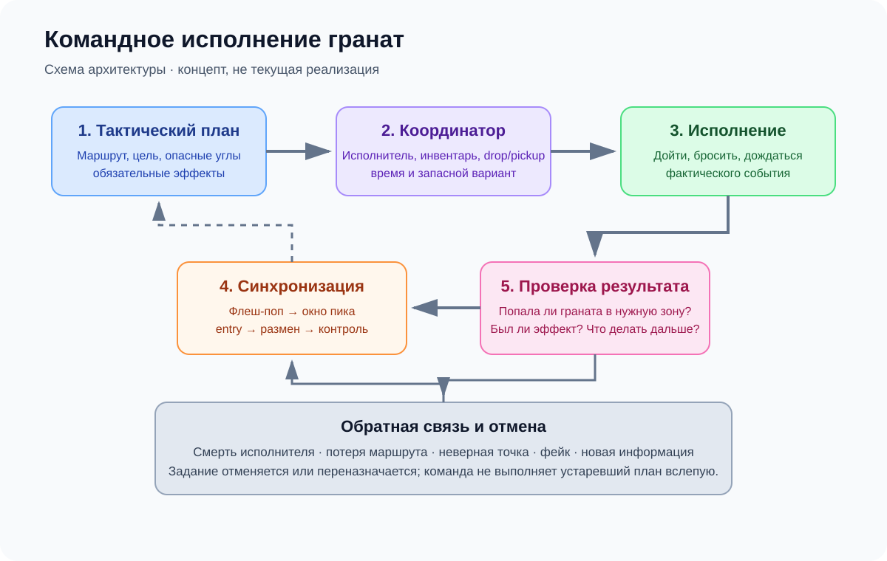
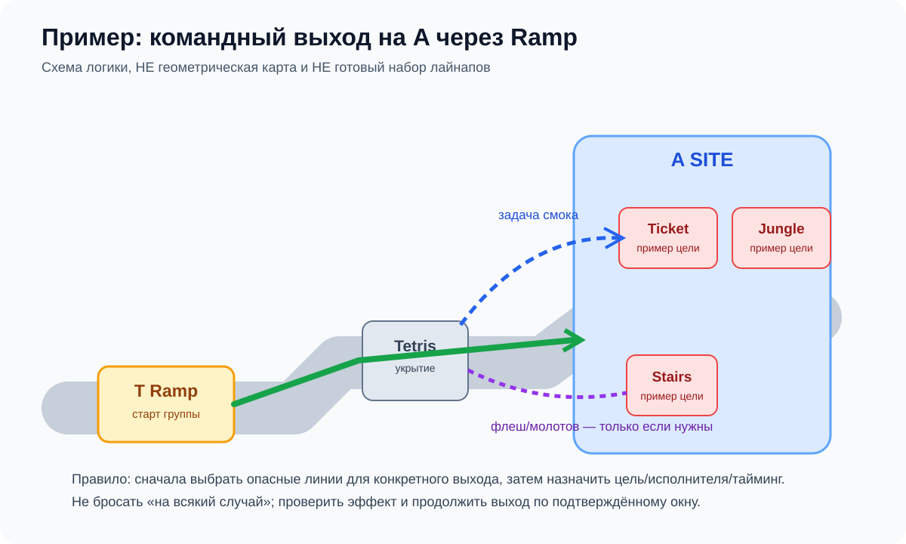

# Командный раскид: планирование, исполнители, drop/pickup и реакция на utility

**Статус:** проектное предложение / спецификация для расследования.  
**Не является:** заявлением, что описанная система уже реализована в `main`.  
**Ограничение:** сначала сверить этот документ с текущим commit, `docs/tasks/nades_plan.md`, `docs/PRINCIPLES.md`, `docs/reports/G1.md` и фактическими точками входа. Код этим документом не изменяется.

## 0. Исторические результаты уже выполненной попытки (не текущий baseline)

В предыдущем разборе проекта был просмотрен [`docs/reports/G1.md`](https://github.com/xa11mono/sim-cs2/blob/main/docs/reports/G1.md), в котором описан эксперимент ветки `g1-v399` от 22 октября 2026 года. В том отчёте зафиксировано:

- общее количество брошенных гранат стало ближе к профессиональным матчам, но нужные гранаты для конкретного маршрута всё ещё часто отсутствовали;
- около **48–68% задач на гранаты выхода** имели свободного подходящего игрока у точки броска в момент выхода;
- задания терялись из-за истечения срока, невозможности выполнить бросок, перестановки, гибели и ротаций;
- доля гранат выхода, оказавшихся в предусмотренной зоне, выросла в том эксперименте с **21% до 27% на Mirage** и с **23% до 32% на Ancient**;
- критерий приёмки не был выполнен, поэтому ветка не была слита в `main`.

Это исторические числа из отчёта конкретной экспериментальной ветки, а не доказательство текущего состояния `main`. Перед использованием их как baseline повторно проверьте commit, методику измерения и сам отчёт. Но они задают верное направление расследования: улучшение общего числа бросков не означает, что команда доставляет нужную utility в нужное место и в нужный момент.

## 1. Цель

Боты должны бросать гранаты не потому, что случайно выбрали лайнап, а потому что команда выбрала тактическую задачу, граната нужна для этой задачи, исполнитель способен выполнить её в срок, а команда знает, какое действие должно последовать за эффектом гранаты.

Система должна решать весь цикл:

1. Выбрать тактику и маршрут.
2. Определить опасные для маршрута линии обзора/пространства.
3. Сформировать набор **необходимых эффектов**, а не просто список имён гранат.
4. Назначить исполнителей с учётом ролей, инвентаря, позиции, пути и времени.
5. При необходимости организовать передачу гранат через реальные игровые действия drop/pickup.
6. Синхронизировать броски с выходом, пиком и разменом.
7. Проверить фактический результат броска и эффекта.
8. Отменить/переназначить устаревшие задания, когда ситуация изменилась.

## 2. Иллюстрация: зачем тактике нужна цель

Пример реальной геометрии Mirage A Ramp → A Site можно посмотреть в открытом гайде CSNADES. Это только визуальная справка, а не эталон геометрии или обязательный набор гранат:

Источник изображения: [CSNADES.gg — Mirage Jungle from A Ramp](https://csnades.gg/mirage/smokes/jungle-from-a-ramp). Изображение удалённое и может зависеть от доступности стороннего хоста; перед повторной публикацией проверьте условия использования источника.

Дополнительная визуальная ссылка на пример lineup Tetris → Jungle (также внешний источник):

Источник: [CS2Nades — Tetris to Jungle](https://cs2nades.gg/map/mirage/smoke/tetris-to-jungle). Это иллюстрация результата lineup, а не предписание, что каждый выход обязан использовать именно его.

Условная схема тактической логики (не точная карта и не lineup):

Для выхода через A Ramp система не должна вслепую кидать любую гранату из библиотеки. Она должна определить, какие реальные линии могут угрожать выбранному маршруту на основе карты, доступных lineup-данных и текущей информации о CT. Примеры целей — перекрыть конкретную линию обзора, вытеснить защитника с подтверждённой/вероятной позиции, дать entry безопасное временное окно или ограничить ротацию. Если позиция не может угрожать маршруту, граната на неё не назначается только ради расхода utility.

## 3. Базовые понятия

### 3.1 План выхода

План выхода содержит:

- `routeId` и фазу (подготовка, выход, закрепление, пост-плант);
- целевой сайт и точку сборки;
- обязательные и необязательные эффекты utility;
- опасные линии/позиции, которые требуется закрыть или подавить;
- порядок и временные зависимости между задачами;
- условие начала выхода и допустимые запасные решения;
- сигналы, при которых план нужно отменить или пересчитать.

Нельзя считать целью «кинуть smoke». Цель должна быть описана игровым эффектом: например, временно убрать линию обзора CT на маршрут entry.

### 3.2 Задача гранаты

Для каждой задачи нужны:

- `taskId`, `planId`, `routeId`, карта и сторона;
- тип гранаты и целевой эффект;
- целевая область/линия/позиция;
- проверенный lineup или допустимый набор альтернатив;
- требуемое временное окно и зависимости;
- исполнитель и причина выбора исполнителя;
- точка броска и достижимость маршрута;
- состояние задания и причина отмены;
- фактическая траектория, столкновения, точка срабатывания и результат эффекта;
- связь с последующим действием команды (peek/entry/размен/занятие пространства).

Если lineup-данные не содержат угла, силы броска или другого параметра, необходимого для однозначного воспроизведения, не выдумывайте его: это отдельная неопределённость, которую надо измерить/калибровать.

## 4. Назначение исполнителей: не привязывать навсегда к IGL

IGL или саппорт может быть предпочтительным исполнителем подготовительных гранат, если у него есть подходящий инвентарь, доступный безопасный путь и достаточно времени, а его отсутствие в первой линии не ухудшит выход. Но правило «всегда кидает IGL» так же плохо, как правило «всегда кидает entry».

Сначала применяйте жёсткие условия выполнимости:

1. У игрока действительно есть нужная граната или есть реалистичный план получить её.
2. Точка броска достижима с учётом времени и угроз.
3. Бросок будет выполнен в допустимом окне.
4. Исполнитель не пропустит критическую командную задачу (например, первый контакт или размен), если это не было осознанным тактическим выбором.
5. После броска игрок сможет занять следующую назначенную позицию либо его вклад уже учтён в плане.

Только среди выполнимых вариантов выбирайте наименее дорогого по времени/риску исполнителя. Не используйте необоснованные фиксированные веса до измерения базового поведения.

## 5. Drop/pickup: передать utility одному назначенному исполнителю

В CS2 есть механика выбрасывания гранат товарищу. Документация переменных сервера указывает `mp_drop_grenade_enable` как переключатель, разрешающий выбрасывать гранаты; в турнирах также встречаются разрешённые бинды для drop. При этом правила покупки не следует смешивать с передачей предмета: официальный апдейт CS2 от **22 сентября 2026 года** уточняет, что `ammo_grenade_limit_total` также ограничивает общее число гранат, которые игрок может **купить за раунд**. Это само по себе не отвечает на все вопросы о подборе выброшенных гранат и текущем слоте инвентаря — их необходимо проверить в актуальном игровом билде.

Источники:

- [Valve — Counter-Strike 2 Update, 22 сентября 2026](https://www.counter-strike.net/newsentry/674006995886407685?l=english)
- [Справочник CS2 convars: `mp_drop_grenade_enable`](https://s2v.app/SchemaExplorer/cs2/convars)
- [ProSettings — How to Practice Smokes and Nades in CS2](https://prosettings.net/blog/how-to-practice-smokes-and-nades-in-cs2/)

### Требуемая модель

В симуляторе необходимо отдельно учитывать:

- `purchasedThisRound` — сколько гранат игрок купил в этом раунде;
- `heldInventory` — гранаты, которые он держит сейчас, с учётом реальных слотов и лимитов;
- `worldDroppedItems` — физические объекты гранат в мире;
- `pickupEligibility` — может ли игрок подобрать данный предмет при текущем инвентаре и правилах;
- `utilityTaskOwner` — кто должен выполнить задачу, независимо от того, кто изначально купил предмет;
- фактические события `drop` и `pickup`, время и позиции.

**Не считайте автоматическую передачу предмета допустимым shortcut.** Передача должна произойти только после того, как предмет действительно выброшен и подобран. Нельзя телепортировать гранату между инвентарями, игнорировать лимиты или создавать копию при drop/pickup.

### Сценарий «один игрок раскидывает план»

1. Во время закупки планировщик определяет требуемые гранаты и закупки всей команды, учитывая экономику и актуальный лимит покупки.
2. Игроки, которым не нужно сохранять конкретную гранату для ближайшего действия, могут сбросить запланированный предмет в безопасной точке сбора.
3. Назначенный utility-исполнитель подходит к точке и подбирает только то, что реально помещается в его инвентарь по правилам актуальной игры.
4. Планировщик распределяет броски по порядку и временным окнам. После броска исполнитель может подобрать следующую гранату, **только если это физически возможно и не опаздывает по таймингу**.
5. Если вместимости или времени недостаточно, план должен разделить набор между двумя исполнителями, а не считать, что один игрок может нести бесконечное число гранат.
6. Игроки не должны стоять без дела у точки сбора, если безопасная передача невозможна или уже поздно выполнять раскид.

Не делайте «один игрок выполняет весь раскид» обязательным для каждой тактики. Это допустимый план, если он соответствует фактической механике инвентаря и не портит тайминг выхода. Для синхронных флешек часто полезнее разделить роли: preparatory utility, флеш под пик и entry/second contact.

### Проверки перед внедрением

На актуальном CS2 отдельно проверить и записать:

- какие типы гранат можно вручную выбросить в каждом используемом режиме;
- как работают выбрасывание и подбор при заполненном/частично заполненном инвентаре;
- меняет ли pickup счётчик числа покупок за раунд или только текущее содержимое инвентаря;
- какие предметы исчезают/сохраняются и сколько времени доступны;
- как drop/pickup взаимодействуют с таймером закупки и состоянием раунда.

Не переносите результаты одного режима/версии на все режимы автоматически.

## 6. Синхронизация: «флешку кинул, но никто не вышел»

Для флешки под пик задача должна включать две связанные сущности: бросок и действие, которое использует эффект. Сам факт броска не означает успешность плана.

Различайте события:

1. `throw_started` — игрок начал исполнение;
2. `grenade_released` — граната фактически выпущена;
3. `grenade_detonated` — граната сработала;
4. `effect_observed` — симуляция подтверждает эффект в целевой зоне;
5. `peek_window_open` — открывается рассчитанное временное окно для пика;
6. `entry_started` — назначенный игрок начал движение/пик;
7. `trade_support_ready` — следующий игрок способен разменять;
8. `task_completed` или `task_aborted` — результат и причина.

Временной расчёт должен учитывать фактический/смоделированный полёт и отскоки, а не случайную задержку после броска. `peek_window_open` не должен заставлять игрока слепо выходить, если путь перекрыт, он уже получил контакт или новая информация изменила решение. Но и отсутствие связи между флешкой и следующим действием недопустимо.

Для собственной флешки entry учитывайте направление взгляда, прикрытие и возможность укрыться от эффекта. Для флешки союзника оценивайте союзников в зоне ослепления, чтобы не разрушать собственную атаку.

## 7. CT: реакция на utility без wallhack и без жёсткого правила

CT должны реагировать на наблюдаемые события и вероятности, а не знать, что именно задумал противник.

- Смок закрывает линию обзора — пересмотреть угол/позицию и возможности обхода; не обязательно отступать.
- Флешка замечена в полёте/слышен сигнал — отвернуться или уйти за укрытие, если времени достаточно; после эффекта выбрать момент повторного пика.
- Несколько гранат плюс шаги/контакт/известная позиция — усилить гипотезу выхода, запросить поддержку или ротировать, если стоимость такой ротации оправдана.
- Только один смок без дальнейших признаков — сохранять возможность фейка; не делать вывод «точно выход».
- Контр-агрессия допустима лишь если рассчитаны время, путь, риск прострела и поддержка; это не автоматическая реакция на дым.

Сохраняйте происхождение каждого знания: личное наблюдение, звук, сообщение союзника или вывод по паттерну. Вывод по паттерну должен быть вероятностным и стареть со временем. Не передавайте точные позиции врагов всем ботам без игрового основания.

## 8. Случайность допустима только среди равноценных вариантов

Нельзя случайным образом выбирать любую гранату/позицию, если это меняет цель тактики. Допускайте seed-зависимый выбор только между вариантами, которые прошли фильтры:

- соответствуют выбранному маршруту;
- блокируют реальную потенциальную линию/позицию;
- подходят под актуальную геометрию и lineup;
- выполнимы данным исполнителем;
- укладываются в тайминг;
- не дублируют уже достигнутый эффект без причины.

Если ни один кандидат не подходит, правильное действие — не бросать гранату, сообщить/зафиксировать причину и пересчитать план.

## 9. Наблюдаемость и метрики

Каждая гранатная задача должна оставлять трассу, чтобы выяснить, где именно потерян результат:

`plan_created → candidate_lineups → assignment → travel_started → ready_at_spot → grenade_released → collision_events → detonation → effect_result → dependent_action → completion/abort`.

Логируйте причины отмены отдельно: `no_inventory`, `pickup_failed`, `unreachable_spot`, `late_for_window`, `executor_dead`, `route_changed`, `enemy_contact`, `plan_replaced`, `trajectory_invalid`, `effect_missed`, `no_follow_up_action`.

Основные метрики:

- доля задач с подходящим исполнителем;
- доля исполнителей, прибывших вовремя;
- доля успешно выполненных бросков;
- доля гранат, попавших в требуемую зону;
- доля достигнутых целевых эффектов;
- задержка от эффекта до требуемого действия;
- доля флешек под пик, после которых назначенный пик фактически произошёл в окне;
- доля ненужных/необоснованных бросков;
- число утраченных задач по каждой причине;
- число регрессий по карте/маршруту/стороне.

Количество потраченных гранат и общий win rate по отдельности не являются критериями успеха.

## 10. План реализации после подтверждения текущего состояния

1. **Baseline и трассировка.** Запустить существующие сценарии, сохранить seed и логи; определить текущие причины потери задач без изменений игровой логики.
2. **Цели/план маршрута.** Проверить, что набор utility выводится из тактики, а не случайного выбора lineup.
3. **Распределение исполнителей.** Проверить доступность гранат, время пути, роли и время следующей задачи.
4. **Реальные drop/pickup.** Добавить модель предметов в мире только после проверки текущих правил CS2 и существующего состояния инвентаря.
5. **Синхронизация флеш → пик → размен.** Использовать события полёта/эффекта и связанные задачи.
6. **Реакция CT.** Внедрить/уточнить belief по наблюдаемым сигналам, не раскрывая CT скрытое состояние T.
7. **Регрессии и сравнение.** Повторить одинаковые seed/сценарии и сравнить результаты по каждому маршруту.

## 11. Критерии приёмки

Изменение не считается исправлением, пока не выполнены все применимые условия:

- каждый бросок связан с тактической целью;
- обязательная utility по выбранному маршруту назначается до выхода либо план корректно пересчитывается;
- исполнителю реально доступна граната, включая фактический drop/pickup при необходимости;
- при невозможном тайминге задача отменяется/переназначается до того, как команда безвозвратно потеряла окно;
- предназначенная для пика флешка связана с временным окном пика, а не просто с фактом броска;
- CT не получают информацию без наблюдаемого источника;
- случайный выбор происходит только между подходящими кандидатами;
- исходные lineup-данные не портятся молча;
- проверены минимум один положительный, один граничный и один негативный сценарий на каждый изменённый механизм;
- отчёт содержит фактический diff, запущенные тесты, baseline/candidate-метрики и известные ограничения.

Перед изменением кода проверь существующие документы/ветки по этой задаче. Не создавай вторую параллельную систему, если предыдущая уже существует, но не была объединена или не прошла приёмку. Сначала объясни, почему предыдущая попытка не сработала, и дождись разрешения на соответствующий этап.
